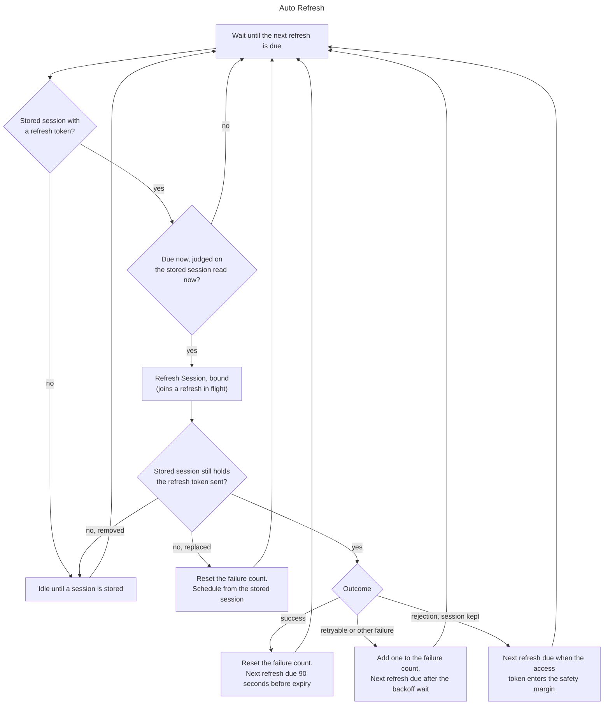

# Auto Refresh

Refresh the stored session in the background before its access token expires,
so that while the loop runs, the app and every platform service client that
reads the session hold a valid access token without waiting for a refresh.

This spec defines when the loop starts a refresh, how long it waits after a
failed one, and how the app and the platform's lifecycle start and stop it.
What a single refresh does to the stored session, including its own retries,
is [Refresh Session](refresh_session.md)'s to define.

This spec applies to SDKs that hold a session on behalf of users. Stateless
server-side SDKs hold no session and do not implement it.

## API

Auto Refresh sends no request of its own. Each refresh it starts goes through
[Refresh Session](refresh_session.md) and
`POST /token?grant_type=refresh_token`.

## Behavior

The loop belongs to the auth client, not to a session. While it runs and a
session is stored, it starts a bound refresh, as
[Refresh Session](refresh_session.md) defines it, each time a refresh is due.
While no session is stored it sends nothing and waits for one.

The sections below define each step and give the reasons.

### When a refresh is due

A refresh is due 90 seconds before the stored access token's `exp` claim, on
the local clock. The lead time is three times the
[safety margin](refresh_session.md#safety-margin) of 30 seconds:

- A refresh that starts 90 seconds before expiry has finished its
  [retries](refresh_session.md#retryable-failures), which stop 30 seconds
  after the first attempt, while 60 seconds remain.
- That leaves room for a second refresh after a failure to start before the
  token enters the safety margin, where [Get Session](get_session.md) starts
  refreshing on its own and makes its callers wait for the answer. The second
  refresh's retries can run into the margin, and Get Session calls made then
  join it.
- For tokens that live 180 seconds or more, a loop refresh that succeeds
  before the margin means Get Session never finds an access token inside it,
  so the app's calls stay local reads.

A refresh is never due sooner than half the access token's lifetime after this
instance received the session in an answer from the server, from its own
refresh or sign-in. The lifetime is the token's `exp` claim minus its `iat`
claim, or `expires_in` when the token carries no `iat`. The time received is
on the local clock, so the rule holds whatever offset the local clock has from
the server's. A session this instance did not receive, one loaded from storage
at start-up or written by another instance, has no such time, so only the
90-second rule applies to it. The rule covers two cases in which the 90-second
rule alone would refresh again as soon as each refresh succeeds:

- A project whose access tokens live less than 180 seconds. With a lifetime
  of 60 seconds or less the loop's refresh falls due inside the safety margin,
  and Get Session calls made then join it.
- A device clock running ahead of the server's by more than the token's
  lifetime minus 90 seconds, so every new token looks about to expire on
  arrival.

The loop judges the due time on the stored session as it reads it when the
time comes, not on the session it saw when it scheduled the refresh. When
another actor stored a newer session meanwhile, such as Get Session's
refresh, a sign-in, or another instance on the same storage, the loop
schedules from that session instead and sends nothing.

The loop starts a refresh no later than 10 seconds after it is due. An SDK may
meet this with a timer set for the due time or with a periodic tick at most
10 seconds apart. A refresh that fell due while the process was suspended or
the device slept starts within 10 seconds of the loop running again (see
[Notes](#notes)).

A session loaded from storage at start-up whose refresh is already due, for
example because the app was closed for longer than the token's lifetime, is
refreshed within 10 seconds of the load.

### After a failed refresh

When a refresh fails with a retryable failure or any other failure that keeps
the session, as [Refresh Session](refresh_session.md) classifies them, the loop
adds one to its failure count and waits before the next refresh starts. The
refresh has already retried within its 30-second deadline, so the wait is
between refreshes, not between requests.

The wait after failure *n*, counting from 1, is 10 seconds times 2^(n-1),
capped at 10 minutes. The SDK multiplies each wait by a factor drawn at random
between 0.5 and 1.0, once per wait, so devices that failed at the same moment
do not all refresh again at the same moment:

| Failure | Wait before jitter | Wait after jitter  |
| ------- | ------------------ | ------------------ |
| 1       | 10 seconds         | 5 to 10 seconds    |
| 2       | 20 seconds         | 10 to 20 seconds   |
| 3       | 40 seconds         | 20 to 40 seconds   |
| 4       | 80 seconds         | 40 to 80 seconds   |
| 5       | 160 seconds        | 80 to 160 seconds  |
| 6       | 320 seconds        | 160 to 320 seconds |
| 7 on    | 10 minutes         | 5 to 10 minutes    |

When the last answer of the failed refresh carried a `Retry-After` header with
a value [Retry Options](../../client/request_configuration/retry_options.md#retry-after)
accepts, the wait is the longer of the jittered wait and the header's value,
capped at 10 minutes. The cap keeps a proxy that answers with a long
`Retry-After` from stopping the loop for hours.

The failure count goes back to zero when a refresh succeeds and whenever the
stored session changes to one with another refresh token, whoever changed it.
The new session is scheduled as [When a refresh is due](#when-a-refresh-is-due)
defines.

Through a steady failure of `/token`, such as an auth hook that answers `500`
to every refresh, each refresh sends at most eight requests within its
30-second deadline. The loop then sends at most 56 requests over seven
refreshes until the wait reaches its cap, which takes up to 14 minutes, and
eight every 5 to 10 minutes after that: about one request a minute. Refreshes
the app or Get Session start are not part of this budget (see
[Shared state with other refreshes](#shared-state-with-other-refreshes)).

### When the stored session changed during the refresh

Before acting on a refresh's outcome, the loop reads the stored session. When
it no longer holds the refresh token the refresh sent, because another actor
removed or replaced it while the request was in flight, the outcome says
nothing about the stored session, whatever it was: a success Refresh Session
discarded, a rejection it returned without acting on, or a failure. The loop
does not add to the failure count. It resets the count and schedules from the
stored session as it is now, or idles when none is stored. The sections below
apply only while the stored session still holds the refresh token sent.

### After a rejected refresh

A rejection does not add to the failure count. Refresh Session decides what it
does to the stored session:

- When it removed the local session, the loop has no session and idles.
- When it kept the session because the access token has more than 30 seconds
  left, it remembers the rejection. The loop's next refresh is due when the
  access token enters the
  [safety margin](refresh_session.md#safety-margin), 30 seconds before its
  `exp` claim. That refresh finds the
  [remembered rejection](refresh_session.md#remembered-rejections), sends no
  request, and removes the local session with the session-expired reason. This
  is how an app that did not call the refresh learns of the rejection on time.

### Does the loop give up

No. While a session is stored, the loop keeps refreshing on the schedule
above, after the access token has expired too:

- A retryable failure says nothing about whether the session is still alive.
  An outage of `/token`, or a device without a network, can end at any time,
  and the stored refresh token works again once it does.
- The loop never removes the session itself. Only a rejection removes it, as
  Refresh Session defines, and the loop stops sending requests once it has.
- The backoff cap keeps the loop of a device that never reaches the server at
  about one request a minute.

### Shared state with other refreshes

The loop has no refresh of its own. It starts the same bound refresh the app
and Get Session start, so:

- When a refresh of the stored refresh token is already in flight, the loop
  joins it and sends nothing, as
  [One refresh at a time](refresh_session.md#one-refresh-at-a-time) defines.
- The outcome of a refresh of the stored session counts for the loop whoever
  started it. A success resets the failure count and schedules the next
  refresh from the new session. A retryable or other failure adds one to the
  failure count and starts the backoff wait, so the loop does not send the
  same failing request right after Get Session's refresh failed. A rejection
  schedules the refresh at the safety margin.
- The loop's failure count and backoff wait apply to the loop only. A refresh
  the app or Get Session starts during a backoff wait is sent at once, since a
  caller is waiting for it. How often those refreshes reach the server during
  an outage is Refresh Session's to bound, not this spec's.

Instances on the same storage, such as browser tabs or app extensions, each run
their own loop. They do not have to coordinate. The re-read of the stored
session before each refresh keeps an instance from refreshing a session
another instance has just refreshed, and two instances that send the same
refresh token at the same moment both get the current session, because the
server accepts the token immediately before the current one (see
[Server settings](refresh_session.md#server-settings)).

### Starting and stopping

The SDK has a construction-time option that enables the loop, on by default.
With it on, the SDK starts the loop once the initial load of the stored session
has completed, and it starts and stops the loop on the platform's lifecycle as
the next section defines. With it off, the SDK never starts the loop on its own.

The auth client has public methods to start and stop the loop. They work
whatever the option says:

- **Start** starts the loop when it is not running. A start before the initial
  load of the stored session has completed takes effect once the load has
  completed, so the loop schedules from the loaded session rather than idling
  for want of one. A refresh that fell due while the loop was stopped starts
  at once. A backoff wait keeps running: its end is a point in time on the
  local clock, set when the failure happened, and stopping and starting the
  loop does not move it. Without that, an app moved to the foreground and back
  every few seconds during an outage would refresh on every return. Starting
  a running loop does nothing.
- **Stop** stops the loop when it is running. No refresh starts until the loop
  is started again. A refresh in flight is not cancelled, since another
  caller may have joined it, and its outcome is applied to the stored session
  as Refresh Session defines. The failure count and the end of a backoff wait
  are kept. Stopping a stopped loop does nothing.

Once the app calls start or stop, the SDK no longer starts or stops the loop
on the platform's lifecycle. The app has taken control, and an SDK that
restarted a loop the app stopped when the app returns to the foreground would
undo the app's choice.

Signing out does not stop the loop. It removes the stored session, so the loop
idles, and the next sign-in is refreshed on schedule without another start.

Disposing of the auth client, where the SDK has such a call, stops the loop for
good.

### Background and foreground

Where the platform tells the app that it moved to the background and back,
such as a browser tab's visibility or a mobile app's lifecycle, the SDK with
the option on stops the loop when the app moves to the background and starts
it when the app returns, as the start and stop methods define:

- The platform suspends or throttles a background app's timers anyway, so the
  loop could not keep its schedule there.
- A refresh in the background spends battery and data for a user who is not
  using the app, and browser tabs in the background would each refresh the
  same session.
- On return, a refresh that fell due in the background starts at once, unless
  a backoff wait is still running, so the app has a valid access token by the
  time it sends its first request, or Get Session finds the refresh in flight
  and joins it.

The cost is that the access token can expire while the app is in the
background. A connection that stays open there, such as a Realtime channel in
a hidden browser tab, keeps the access token it last received until the loop
refreshes on return and the token-refreshed event hands it the new one. What
such a connection does with an expired token is its own capability's to
define.

On platforms without such a lifecycle, such as desktop processes and servers,
the loop runs until it is stopped.

### Events and errors

The loop emits no auth event of its own. The refreshes it starts emit the
token-refreshed event on success and the sign-out event when a rejection
removes the session, as Refresh Session defines.

A failure of a refresh the loop started reaches no caller. The SDK does not
raise it as an unhandled error. It reports it through
[Diagnostic Logging](../../client/observability/diagnostic_logging.md), at a
severity above debug, since the loop is background work with no caller to
return the error to. Each scheduling decision, such as the next due time and
the backoff wait, is a debug-level emission.

## Notes

- A timer measured on a clock that stops while the device sleeps, such as a
  monotonic clock on some platforms, fires late by the time the device slept.
  An SDK that sets one timer for the due time re-checks the due time on the
  local clock when the platform reports that the app resumed or the device
  woke, or uses a periodic tick that does.
- On a server that holds a session per user in a value the process keeps, the
  loop would refresh every value the process holds, whether or not a request
  needs it. Such SDKs document that the option should be off there, and leave
  refreshing to the Get Session call each request makes.
- Which answers end a session, how a single refresh retries, and how a
  refresh shares one request with concurrent callers are
  [Refresh Session](refresh_session.md)'s to define. A cooldown on refreshes
  other callers start is outside this spec.

## Related

- [Refresh Session](refresh_session.md): the bound refresh the loop starts,
  and the owner of what it does to the stored session.
- [Get Session](get_session.md): refreshes when the access token enters the
  safety margin, whether or not the loop runs. The loop's lead time keeps it
  from having to.
- [Retry Options](../../client/request_configuration/retry_options.md): the
  `Retry-After` values the backoff wait honours.
- [Sign-Out Reason](sign_out_reason.md): a rejection the loop's refresh acts on
  produces the session-expired reason.
- [Diagnostic Logging](../../client/observability/diagnostic_logging.md): where
  the loop reports its failures and scheduling decisions.
- Subscribe to Auth Events (`auth.session.subscribe_auth_events`): the stream
  the refreshes the loop starts emit their events on.
