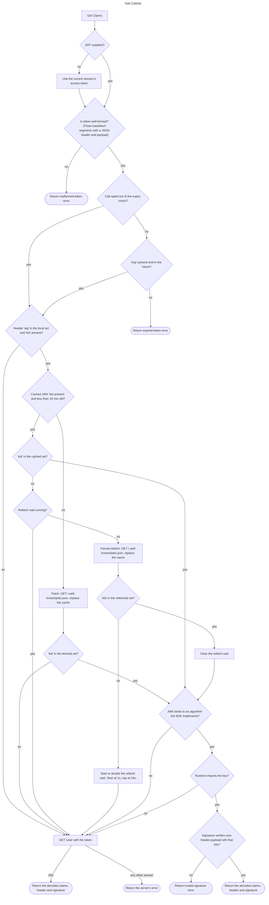

# Get Claims

Verify a JWT access token and return its claims, together with the token's decoded header and raw signature bytes. This is the fast path for request-time authentication: it establishes who the user is and how they authenticated using the project's published public keys, without a per-request round trip to the Auth server whenever local verification is possible.

## API

Spec: [https://github.com/supabase/auth/blob/master/openapi.yaml](https://github.com/supabase/auth/blob/master/openapi.yaml)

- `GET /.well-known/jwks.json` - fetches the project's published JWK Set on a key-cache miss
- `GET /user` - the server-side verification fallback for tokens that cannot be verified locally

## Behavior

The input is a JWT access token. SDKs that hold a session default to the current session's access token when none is supplied, and stateless server-side SDKs require it explicitly. The flowchart is the exact logic.

The steps below give the reasons and further details, cheapest first:

1. **Decode.** The token must be three base64url segments carrying a JSON header and JSON payload. Malformed input fails here with no network traffic. The header's `alg` is read as an opaque string: a value outside the set the SDK implements is input to step 3, never a decode failure.
2. **Expiry.** The `exp` claim must be present and in the future, judged against the local clock with no skew allowance. The call may take a per-call opt-out from this check, off by default, for callers that inspect a token they already know has expired. It is a parameter of the call, not a project or server setting. When set it skips this check and nothing else: the signature is still verified, and on the server fallback the server still rejects an expired token (see [Errors](#errors)), so the opt-out only changes the outcome of a token verified locally. When no token is supplied, the session's access token has already been refreshed by the SDK where it could be, so the opt-out matters for a token the caller supplies.
3. **Route.** If the header's `alg` is one of the asymmetric algorithms under [Signing algorithms](#signing-algorithms) and the header names a key id (`kid`), verification is local. Any other token - one whose `alg` is absent, `none`, any `HS` value or a value the SDK does not implement, or that names no `kid` - is verified by calling [Get User](auth.session.get_user) instead: a successful response proves the server accepts the token, and the claims from step 1's decode are returned.
4. **Resolve the key.** The JWK Set is downloaded when the cache is empty or older than ten minutes, and a `kid` missing from that fresh document takes the step 3 fallback with no further download. Otherwise the `kid` is looked up in the cached JWK Set. A `kid` missing from a cache that is still fresh forces a refetch, a download inside the ten minutes that replaces the cache, so freshly rotated signing keys are usable immediately. SDKs should rate-limit these forced refetches with exponential backoff: while consecutive forced fetches fail to resolve the `kid` that forced them, double the wait before the next one (for example one second up to a sixteen-second backstop), and clear the wait once a fetch resolves its `kid`. Misses inside the wait resolve as unknown and take the step 3 fallback, so a storm of attacker-minted `kid`s decays to a bounded fetch rate while a genuine rotation still verifies - immediately when the backoff is clear, via the fallback during a storm. If the refetched document still lacks the `kid`, fall back to server-side verification as in step 3.
5. **Bind.** The verification algorithm is bound from the matched JWK, as defined under [Signing algorithms](#signing-algorithms). A JWK the SDK cannot bind, or a key the runtime cannot import, takes the step 3 fallback.
6. **Verify.** The signature is checked over the `header.payload` signing input using the bound algorithm and the matched public key. Success returns the claims, the decoded header and the raw signature bytes. Failure is an invalid-signature error.

The JWK Set is cached in the client for ten minutes, matching the `Cache-Control: public, max-age=600` the endpoint serves. The cache is shared across calls, and concurrent misses should coalesce into a single fetch.

### Signing algorithms

The verification algorithm is bound from the **matched JWK**, not from the token header: the JWK's `alg` when present, otherwise inferred from its `kty` and `crv`. The attacker controls the header but not the published key set, so keying off the JWK removes the algorithm-confusion bug class by construction. The header's `alg` decides only whether step 3 looks a key up; it never selects how the key is used, so a header of `none` or `HS256` with a `kid` still has to satisfy the matched key's own algorithm, which an unsigned or HMAC-signed token cannot.

Local verification covers these bindings:

- `RS256`: a JWK with `kty: RSA`, verified as RSASSA-PKCS1-v1_5 with SHA-256.
- `ES256`: a JWK with `kty: EC` and `crv: P-256`, verified as ECDSA with SHA-256. The JWS signature is the 64-byte concatenation of `r` and `s`, not a DER sequence; a runtime whose verifier expects DER needs the conversion before the check.
- `EdDSA`: a JWK with `kty: OKP`, verified as EdDSA (RFC 8032) over the curve the JWK's `crv` names. `EdDSA` is a polymorphic name, so the curve comes from the key and never from the header. Every SDK binds `crv: Ed25519` (a 64-byte signature). An SDK whose runtime provides Ed448 binds `crv: Ed448` (a 114-byte signature) the same way; one whose runtime does not takes the fallback for such a key.

The fully specified names `Ed25519` and `Ed448` (RFC 9864) are equivalent to `EdDSA`, in the header for step 3 and in the JWK's `alg` for binding. A JWK whose `alg` names one curve while its `crv` names another is not bound and takes the fallback.

A header `alg` outside this set, or a matched JWK the SDK cannot bind - an unknown `kty`, an unknown `crv`, or an `alg` the SDK does not implement, including the other values the server accepts on a signing key, listed in [`GetSigningAlg`](https://github.com/supabase/auth/blob/ce9a8eee0cc042be8c7a42981a7ddae631e41d91/internal/conf/jwk.go#L201-L224) - routes to the server fallback. It is never a client-side error. The server is the authority on which algorithms it signs with, and this rule is what lets a project adopt a signing algorithm the SDK predates without the SDK rejecting valid tokens.

An algorithm the SDK implements but the runtime cannot perform, for example a Web Crypto implementation without Ed25519 or a platform without ECDSA, is treated as one the SDK cannot verify locally: the token takes the server fallback. The SDK learns this from the runtime's own rejection at key import or verification and turns it into the fallback route, never into an invalid-signature error. The cost on such a runtime is one server round trip per call, the same cost an HS256 project pays, and not a failure.

Parsing the JWK Set accepts keys of any `kty` and members the SDK does not read. A key the SDK cannot use stays in the set and still matches by `kid`, so a token signed with it takes the fallback at step 5 rather than the forced refetch of step 4 or a parse error.

## Prerequisites

Local verification requires the project to publish at least one asymmetric signing key. A project still on the legacy symmetric secret publishes an empty `keys` array, which is valid and must route every token through the server-side fallback rather than fail.

## Errors

- Malformed token, expired token and invalid signature are client-side failures, named per SDK convention. The expiry check pre-empts the server's answer to an expired token on the fallback route: HTTP 403 with error code `bad_jwt` and a message starting `invalid JWT: unable to parse or verify signature`. That answer also reaches a caller who opted out of the expiry check and whose token takes the fallback route.
- A signing algorithm the SDK or its runtime cannot verify is not a client-side failure. The token takes the server fallback of step 3, and its outcome is the server's.
- When verification falls back to the server, a rejection surfaces the server's error - `bad_jwt`, `session_not_found` and similar codes pass through from [Get User](auth.session.get_user).

## Notes

- The JWK Set endpoint serves only public keys. A public key can check a signature but never produce one, so the document is safe to serve unauthenticated and safe to cache. A symmetric legacy secret could mint tokens if published, which is why it never appears there and why those tokens take the server round trip.
- Verified claims prove identity as of token minting. They cannot prove the session still exists: a revoked session's token keeps verifying locally until it expires. Decisions that must respect revocation belong on [Get User](auth.session.get_user).
- Runtime key importers differ on which `alg` an OKP JWK may carry: some accept only `EdDSA` (RFC 8037), others also `Ed25519` and `Ed448` (RFC 9864). An SDK that hands the JWK to the runtime's importer removes `alg` first. The algorithm was bound from `kty` and `crv` already, so the member adds nothing and is only a source of spurious import failures.
- The keys a project can choose, and which the platform recommends, are in the [JWT Signing Keys guide](https://supabase.com/docs/guides/auth/signing-keys). The guide owns that list; this spec only fixes what an SDK does with each.

## Related

- [Get User](auth.session.get_user) - the server-side fallback, and the revocation-aware alternative when freshness matters
