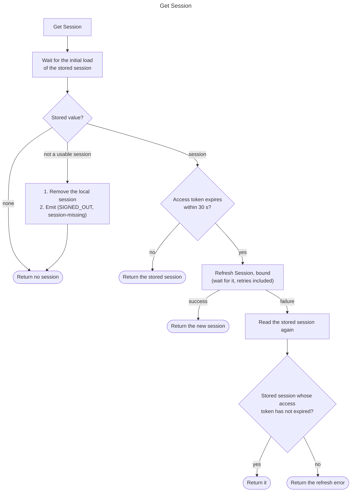

# Get Session

Return the stored session with an access token that is valid when the call
returns, refreshing the session first when the access token is about to
expire. It is the call an app makes to learn whether a user is signed in, and
the path other capabilities take to the current access token when the app
supplies none.

This spec applies to SDKs that hold a session on behalf of users. SDKs that
leave that up to users of the SDK are not covered by it.

## API

"Get Session" sends no request of its own, but if a refresh is needed it goes 
through [Refresh Session](refresh_session.md) and 
`POST /token?grant_type=refresh_token`.

This functionality should be exposed through the Auth Client.

## Behavior

"Get Session" takes no input and answers with one of three things: a session,
no session, or an error. No session is not a failure. The flowchart is the 
exact logic.

The sections below give the reasons and further details.

### Reading the stored session

Each call reads the stored session, so a session that another instance on the
same storage, such as another browser tab or an app extension, has stored,
refreshed, or removed is seen by the next call. An SDK whose storage no other
instance writes may keep the session in memory instead, as long as every write
to the stored session updates that copy.

Whether the session Get Session returns is a snapshot or a live value is the
SDK's choice, and the SDK says which in its documentation.

- A **snapshot** is the stored session as it was when the call returned. A
  later refresh, sign-in, or sign-out changes the stored session and not the
  snapshot. An app that wants the current session calls Get Session again or
  subscribes to auth events.
- A **live value** reads the stored session each time the app reads it. Each
  such read is a Get Session call and follows this spec, including the
  refresh and the failure rules, so a refresh the SDK ran since the last read
  is visible through it.

In both, an access token the app has read stays valid until its `exp` claim,
because a refresh revokes no access token, so sending it for the seconds
after a refresh is harmless. A refresh token the app has read may already
have been used by a later refresh, so an app does not keep it to refresh with
later.

An SDK that loads the stored session asynchronously at start-up answers a Get
Session call made before that load completes only once it has completed.
Otherwise, a call made at start-up would see no session and the app would treat
a signed-in user as signed out.

A stored value is a usable session when it decodes as a session and carries an
access token, a refresh token, and an expiry, either stored or read from the
access token's `exp` claim. Any other stored value cannot be repaired by
retrying, so the SDK removes the local session with the session-missing
reason from [Sign-Out Reason](sign_out_reason.md), in SDKs that implement it,
and returns no session and no error. Removing it stops every later call from
failing the same way, and the sign-out event tells the app its user is gone.

The user in the returned session is the one the SDK stored, read from the
stored session or from the separately stored copy of the user object when the
SDK keeps one. Nothing in the returned session is verified (see
[Notes](#notes)).

### When it refreshes

The access token is about to expire when its `exp` claim is 30 seconds or less
away on the local clock. This is the
[safety margin](refresh_session.md#safety-margin) from Refresh Session: inside
it the token is no longer reliable, so Get Session does not hand it out
without trying for a new one. Refreshing earlier would turn a call that is
usually a local read into a request while the token is still good; refreshing
later would hand out a token the margin says is unreliable. The stored expiry
equals the `exp` claim, and an SDK may read either.

Get Session refreshes whether or not Auto Refresh (`auth.session.auto_refresh`)
is enabled. That setting controls the timer. The refresh here is what keeps
Get Session's promise when the timer is off, and when the app was suspended
past the token's expiry before the timer could run.

The refresh is bound, as [Refresh Session](refresh_session.md) defines it.
Get Session waits for it, retries included, and returns what it returns: on
success the new session, which the refresh has already stored and announced
with the token-refreshed event. Concurrent Get Session calls that find the
token about to expire share the one refresh in flight, so many callers cost
one request.

### When the refresh fails

Refresh Session decides what a failed refresh does to the stored session:
kept for a retryable or other failure, removed for a rejection once the
access token expires within 30 seconds. Get Session decides only what to hand
back, and it reads the stored session again to do so, because the refresh may
have removed it, a concurrent sign-out may have, or another instance on the
same storage may have replaced it while the request was in flight.

- When the stored session's access token has not expired, its `exp` claim
  still in the future on the local clock with no margin, Get Session returns
  that session and no error. The token works until `exp` whatever the refresh
  answered (see
  [why the session is kept](refresh_session.md#why-the-session-is-kept-until-the-access-token-expires)),
  and the caller is usually about to send a request, which the remaining
  seconds serve better than an error would. The session returned may be a
  newer one another instance stored, which is why a refresh-discarded error
  never reaches the caller while such a session is fresh.
- Otherwise, when there is no stored session or its access token has expired,
  Get Session returns the refresh's error and no session. The error is the
  refresh's own, so a retryable error stays identifiable as retryable and a
  rejection carries the server's answer. Get Session never substitutes an
  error of its own for it.

The whole retry sequence of the refresh runs inside the call, so a Get
Session call can take as long as
[the refresh's retries](refresh_session.md#retryable-failures). Because those
waits exceed the 30-second margin, a retryable failure usually comes back
after the access token has expired, and the caller gets the error. The kept
session is returned mostly after a failure the refresh does not retry.

### Events

Get Session emits no events of its own. The refresh it starts emits the
token-refreshed event on success and, on a rejection that removes the session,
the sign-out event with the session-expired reason. Removing an unusable
stored value emits the sign-out event with the session-missing reason.

## Errors

No stored session is not an error, and neither is an unusable stored value,
which is removed as described above. The only error Get Session returns is a
failed refresh's, under the conditions in the table.

| Refresh outcome | Stored session afterwards                                      | Get Session returns             |
| --------------- | -------------------------------------------------------------- | ------------------------------- |
| Success         | The new session                                                | The new session, no error       |
| Any failure     | A session whose access token has not expired, kept or replaced | That session, no error          |
| Any failure     | None, or a session whose access token has expired              | The refresh's error, no session |

## Notes

- Stateless server-side SDKs hold no session, so this capability does not
  apply to them. A server-side SDK that holds a session per user in a value
  the process keeps, rather than in the client, is not stateless: it
  implements this capability on that value, as the live value defined under
  [Reading the stored session](#reading-the-stored-session), with the process
  as the storage.
- The returned session is local state the SDK has not verified. In SDKs whose
  storage the app's clients write, such as cookie storage read on a server,
  the user object in it is whatever the client sent, and the access token may
  belong to a revoked session, which local verification keeps accepting until
  `exp`. Code that needs a verified identity calls [Get Claims](get_claims.md),
  and code that needs proof the session still exists calls
  [Get User](get_user.md).

## Related

- [Refresh Session](refresh_session.md): the bound refresh Get Session runs
  when the access token is about to expire, and the owner of what that refresh
  does to the stored session.
- Auto Refresh (`auth.session.auto_refresh`): the timer that refreshes ahead
  of expiry; its setting does not change whether Get Session refreshes.
- [Get User](get_user.md): the server-verified alternative when the session
  must be proven to still exist.
- [Get Claims](get_claims.md): local verification of the access token Get
  Session returns.
- [Sign-Out Reason](sign_out_reason.md): removing an unusable stored value
  produces the session-missing reason.
- Subscribe to Auth Events (`auth.session.subscribe_auth_events`): the stream
  the token-refreshed and sign-out events are emitted on.
