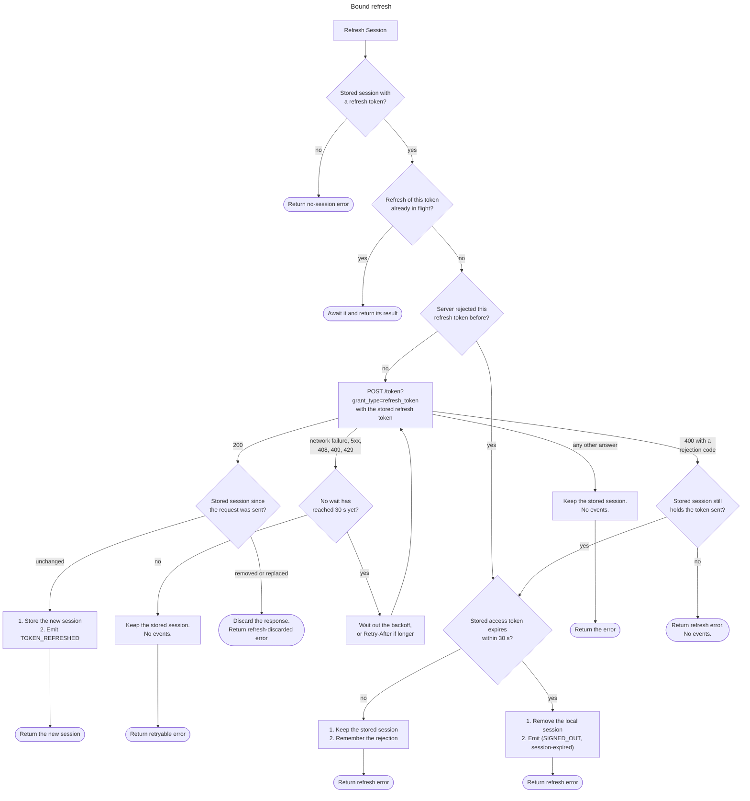

# Refresh Session

Every capability that needs a fresh access token runs this lifecycle, whether
the app calls it directly, the auto-refresh loop calls it before expiry, or
another call needs a valid access token first.

This file is the single definition of what a refresh does to local state. Other
specs should refer to it instead of restating it.

In this spec, a **session** is the set of credentials the Auth server returns
when a user signs in or refreshes: the access token, the refresh token, the
token type (`bearer`), the access token's lifetime in seconds (`expires_in`)
and expiry time (`expires_at`), and the user object.

`expires_at` equals the access token's `exp` claim, and an SDK may read either.
`expires_in` is relative to when the response was sent, so an SDK does not use
it to judge expiry.

## API

Spec: [https://github.com/supabase/auth/blob/master/openapi.yaml](https://github.com/supabase/auth/blob/master/openapi.yaml)

- `POST /token?grant_type=refresh_token`

## Behavior

### Refresh modes

The input is an optional refresh token. Where the token comes from decides the
mode, and the mode decides what the refresh does to local state:

- **Bound**: no token is supplied, so the SDK sends the stored session's
  refresh token. A bound refresh writes its outcome back to the stored
  session and emits events, as the flowchart below defines. Every refresh the
  SDK starts on its own is bound.
- **Supplied**: the app supplies a refresh token that differs from the stored
  session's. On success the SDK stores the result as the new session,
  replacing any stored session, the same way Set Session
  (`auth.session.set_session`) stores supplied tokens. It emits the 
  `TOKEN_REFRESH` event when the new session belongs to the stored session's
  user, and `SIGNED_IN` when it belongs to another user or no session was
  stored. On failure, it leaves the stored session alone and emits nothing, 
  because the token rejected is not the stored session's. A supplied token 
  equal to the stored session's refresh token runs a bound refresh.
- **Detached**: another capability needs a refresh that must not change local
  state. A detached refresh never reads, writes, or removes the stored
  session, emits no events, and makes exactly one attempt. It returns the new
  session or the error to its caller, which decides what to do with either.

### Who calls a refresh

This capability is the only path to `POST /token?grant_type=refresh_token`.
These are its callers, and the mode each one runs:

- **The app**, through one public method on the auth client. The method takes
  an optional refresh token: called without one it runs a bound refresh, and
  called with one it runs a supplied refresh. In SDKs that hold no session
  (stateless server-side SDKs) the token is required and the refresh is
  detached.
- Get Session (`auth.session.get_session`) runs a bound refresh when the
  stored access token is about to expire.
- Auto Refresh (`auth.session.auto_refresh`) runs a bound refresh ahead of
  expiry on a timer.
- [Sign Out](sign_out.md) runs a bound refresh under the `others` and `global`
  scopes, and a detached refresh under `local`.

### Lifecycle of a bound refresh

The flowchart is the exact logic. The sections below give the reasons and the
details that do not fit on it.

A supplied or detached refresh runs a subset of the same steps:

| Step                                                                                   | Bound                                                        | Supplied                                                                                    | Detached        |
| -------------------------------------------------------------------------------------- | ------------------------------------------------------------ | ------------------------------------------------------------------------------------------- | --------------- |
| No-session check                                                                       | Yes                                                          | No, the token is given                                                                      | No              |
| Join an in-flight refresh of the same token                                            | Yes                                                          | Yes                                                                                         | No              |
| [Remembered rejection](#remembered-rejections)                                         | Read and write                                               | Read and write                                                                              | Neither         |
| [Retries](#retryable-failures)                                                         | Yes                                                          | Yes                                                                                         | No, one attempt |
| [Stored-session check](#checking-the-stored-session-after-the-answer) after the answer | Yes                                                          | Yes: store only when the stored session is unchanged since the request was sent             | No              |
| On success                                                                             | Store, emit token-refreshed                                  | Store, replacing any session; emit token-refreshed for the same user, `SIGNED_IN` otherwise | Return only     |
| On rejection                                                                           | Keep until 30 s before the access token expires, then remove | Leave the stored session alone, emit nothing                                                | Return only     |
| On any other failure                                                                   | Keep the stored session                                      | Keep the stored session                                                                     | Return only     |

### One refresh at a time

An SDK instance runs at most one refresh of a given refresh token at a time. A
refresh that starts while a refresh of the same token is in flight sends no
request and returns the result of the one in flight. A detached refresh is the
exception: it never joins a refresh in flight, and none joins it. Two requests with the same
refresh token would make the server answer the later one with the token the
earlier one already received at best, and with `400 refresh_token_already_used`,
ending the session, at worst (see [Server settings](#server-settings)).

Instances that share storage, such as browser tabs or app extensions, cannot
share an in-flight request. The checks on the stored session after the answer,
described next, cover them.

### Checking the stored session after the answer

Before it acts on an answer, a bound or supplied refresh reads the stored
session again and compares its refresh token with the one it sent. Another actor
may have changed the stored session while the request was in flight: a sign-out 
removed it, a sign-in replaced it, or another instance on the same storage
refreshed it first. The comparison has three outcomes:

- **Unchanged**: the stored refresh token is the one sent, and the answer
  applies to the stored session.
- **Removed**: there is no stored session. The SDK must not write a session
  back, which would undo the sign-out, and must not emit a second sign-out
  event.
- **Replaced**: the stored refresh token differs from the one sent. The stored
  session is newer than the answer, so the SDK leaves it alone and emits
  nothing, since the actor that stored it emitted its own event.

In both the removed and the replaced case the SDK returns an error rather than
a session: on success its own refresh-discarded error, since the response was
not stored, and on a rejection the server's error. The caller reads the
stored session again if it wants the current one.

The read, the store, and the removal must not interleave with a concurrent
sign-out. SDKs that serialize session operations behind a lock meet this by
running the whole refresh under it. SDKs that do not must re-check after
writing that no removal happened during the write, and undo the write if one
did, without emitting another event.

### Success

On `200` the SDK stores the returned session in full, replacing the access
token, the refresh token, the expiry, and the user, and then emits the
token-refreshed event through Subscribe to Auth Events
(`auth.session.subscribe_auth_events`). The SDK stores the returned refresh
token even when it equals the one sent: within the reuse interval the server
answers a repeated refresh token with the current one (see
[Server settings](#server-settings)), and the stored session must always hold
the server's current token.

### Retryable failures

A network failure, any `5xx`, `408`, `409 conflict`, and
`429 over_request_rate_limit` mean the server did not judge the refresh token.
The session may still be alive, so the SDK keeps the stored session, emits no
event, and returns an error the app can identify as retryable.

A bound or supplied refresh retries a retryable failure with the same refresh
token, using exponential backoff:

- The first retry waits 200 ms, and each later wait doubles, up to at most
  30 seconds: 200 ms, 400 ms, …, 25.6 s.
- Each wait is then randomized by up to 25% in either direction. The
  30-second limit applies before randomizing, so a randomized wait may exceed
  it. The jitter prevents a thundering herd, clients that failed at the same
  moment do not all retry at the same moment.
- The retry after the first wait that reaches 30 seconds is the last. When it
  fails, the SDK returns its retryable error.

Only the waits count, not the time the requests themselves take. This makes
the total time less predictable, but simplifies the implementation, as the SDK
never has to interrupt a request in flight.

When every retry runs. Their waits add up to 81 seconds without jitter, and to 
between 60.75 and 101.25 seconds with it, plus the time of the 10 requests.

When a response carries a `Retry-After` header, the SDK waits that long before
the next attempt, or the backoff wait when that is longer. A wait that
`Retry-After` brings to 30 seconds or more counts as reaching 30 seconds, so
the retry after it is the last.

Auth does not send `Retry-After` itself, so the header always comes from a
proxy or gateway in front of it.

Retrying with the same token is safe even when the server processed a request
whose answer was lost, because the server accepts the token immediately before
the current one (see [Server settings](#server-settings)).

### Other failures

Any other answer, including a `4xx` with an error code not listed under
[Rejected refresh](#rejected-refresh) and a body that is not an Auth error,
such as an HTML page from a proxy or captive portal, keeps the stored session,
emits no event, and returns the error without a retry. The SDK cannot tell that
the server judged the refresh token, so it does not end a session over it, and
it cannot tell that a retry would get a different answer, so it does not
repeat the request.

### Rejected refresh

A `400` with one of these error codes means the server judged the refresh
token and refused it:

- `refresh_token_not_found`
- `refresh_token_already_used`
- `session_not_found`
- `session_expired`
- `user_banned`
- `validation_failed`

These are the only answers that end a session. [Refresh answers](#refresh-answers)
gives the reason behind each code. All six are handled the same way.

#### What a bound refresh does

A bound refresh handles a rejection according to what the stored session holds
when the answer arrives:

| Stored session's refresh token      | Stored session's access token | The SDK                                                                            | Event                           |
| ----------------------------------- | ----------------------------- | ---------------------------------------------------------------------------------- | ------------------------------- |
| None, or not the refresh token sent | Any                           | Returns the error                                                                  | None                            |
| The refresh token sent              | More than 30 s left           | Keeps the session, remembers the rejection of the refresh token, returns the error | None                            |
| The refresh token sent              | 30 s or less left             | Removes the local session, returns the error                                       | `(SIGNED_OUT, session-expired)` |

The reason comes from [Sign-Out Reason](sign_out_reason.md), in SDKs that
implement it. Removing the local session clears all auth state the SDK
persists for the user:

- the stored session
- every stored PKCE code verifier
- any separately stored copy of the user object

#### Remembered rejections

- The SDK treats a rejection as final and never sends that refresh token
  again.
- It remembers the most recent rejection, with its error. A rejection of the
  stored session's token is kept for as long as the stored session holds that
  token.
- A later bound or supplied refresh of a remembered token sends no request. It
  returns the remembered error and acts on it as the table above shows. Without
  this, every auto-refresh attempt until expiry would send the rejected token
  again.
- The memory lives in the SDK instance only. Another instance on the same
  storage, or the same app after a restart, sends the token once more and gets
  the same answer.
- A detached refresh always sends a request and does not use remembered
  rejections.

#### Safety margin

The SDK treats the stored access token as expired once its `exp` claim is
30 seconds or less away on the local clock. In those last 30 seconds the token
is no longer reliable:

- The device clock may run behind the servers' clocks, so a service can reject
  the token as expired while the device still counts it as valid.
- A request sent just before `exp` can reach a service after `exp` and be
  rejected there.

Keeping a rejected session through that window would leave the app holding a
token that fails unpredictably, so the SDK removes it 30 seconds early.

#### Why the session is kept until the access token expires

- The access token works until its `exp` claim, minus the
  [safety margin](#safety-margin). Services that verify it, such
  as the Data API, Storage, and Realtime, do not ask the Auth server whether
  its session or user is still valid, so they accept it after a sign-out
  elsewhere, a session time-box, or a ban. Removing the session early would
  not take that access away; it would only sign the user out before the token
  stops working.
- A proactive refresh therefore never signs the user out early, and a refresh
  that another instance on the same storage won is not mistaken for a dead
  session.
- Auth's own endpoints are stricter: they reject a banned user's access token
  with `403 user_banned` while the SDK still holds the session.

#### What the app sees

- While the session is kept, no event is emitted. The caller of the refresh
  gets the error.
- An app that did not call the refresh itself, because auto-refresh did,
  learns of the rejection from the sign-out event emitted by the first refresh
  once the access token expires within 30 seconds.

### Server settings

The project's session and refresh token settings decide which answers the SDK
sees. The SDK cannot read these settings, so it handles every answer
regardless of configuration. The `config.toml` column gives the setting's key
in the Supabase CLI's `supabase/config.toml`, where it has one. See the
[sessions guide](https://supabase.com/docs/guides/auth/sessions) and
[cli configuration](https://supabase.com/docs/guides/local-development/cli/config)
for what each setting does.

Auth has two refresh token formats, chosen by a server setting with no
`config.toml` key: v1, the default, stores every token in a table; v2 derives
each token from a per-session counter. Where the two answer differently, the
row says so.

| Setting                                                                           | `config.toml` key                            | Answer the SDK sees                                                                                                                                                                                                                                                                                                                                    | Consequence for the SDK                                                                                                                |
| --------------------------------------------------------------------------------- | -------------------------------------------- | ------------------------------------------------------------------------------------------------------------------------------------------------------------------------------------------------------------------------------------------------------------------------------------------------------------------------------------------------------ | -------------------------------------------------------------------------------------------------------------------------------------- |
| Refresh token rotation on (the default)                                           | `auth.enable_refresh_token_rotation = true`  | A reused refresh token that no reuse allowance below covers gets `400 refresh_token_already_used`. With v1 tokens the server also revokes every refresh token of the session; with v2 it deletes the session.                                                                                                                                          | Rejected refresh. One refresh at a time per instance keeps the SDK from tripping this itself.                                          |
| Refresh token rotation off                                                        | `auth.enable_refresh_token_rotation = false` | The same reuse gets `400 refresh_token_already_used`, and nothing else changes: the session and its other refresh tokens keep working.                                                                                                                                                                                                                 | Rejected refresh. The token sent stays unusable, so the outcome for the stored session is the same.                                    |
| Reuse interval, in seconds (default `10`)                                         | `auth.refresh_token_reuse_interval`          | A refresh token reused within the interval gets `200`. With v2 tokens the interval runs from the session's last refresh and the answer carries the session's current refresh token. With v1 tokens it runs from the moment that token was itself used, and the answer carries a new refresh token; the token the earlier use produced stays valid too. | Success. The SDK must not depend on a nonzero interval, and must not assume the answer carries a token another instance already holds. |
| Always allow refresh token reuse                                                  | None                                         | With v2 tokens, any reused refresh token of a live session gets `200` with the current refresh token. With v1 tokens the setting has no effect.                                                                                                                                                                                                        | Success.                                                                                                                               |
| Previous refresh token accepted (not configurable)                                | None                                         | The refresh token immediately before the current one gets `200` with the current refresh token, with either token format and outside the reuse interval too.                                                                                                                                                                                           | A retry after a lost answer succeeds.                                                                                                  |
| Session time-box (dashboard: **Time-box user sessions**)                          | `auth.sessions.timebox`                      | `400 session_expired` once the session is older than the time-box.                                                                                                                                                                                                                                                                                     | Rejected refresh.                                                                                                                      |
| Inactivity timeout (dashboard: **Inactivity timeout**)                            | `auth.sessions.inactivity_timeout`           | `400 session_expired` once the session has not been refreshed for longer than the timeout.                                                                                                                                                                                                                                                             | Rejected refresh.                                                                                                                      |
| Single session per user (dashboard: **Single session per user**)                  | None                                         | `400 session_expired` once another valid session of the user, with the same tag when tags are set, has refreshed more recently.                                                                                                                                                                                                                        | Rejected refresh.                                                                                                                      |
| Limit on how long an `aal1` session of a user with a verified MFA factor may last | None                                         | `400 session_expired` once such a session is older than the limit.                                                                                                                                                                                                                                                                                     | Rejected refresh. The app has to sign the user in again and complete MFA.                                                              |
| SAML sign-in validity                                                             | None                                         | `400 session_expired` once a session created by a SAML sign-in is past the `SessionNotOnOrAfter` of its assertion.                                                                                                                                                                                                                                     | Rejected refresh.                                                                                                                      |
| Token refresh rate limit, per IP address (default `150` per 5 minutes)            | `auth.rate_limit.token_refresh`              | `429 over_request_rate_limit`, with no `Retry-After` header. The `password`, `pkce` and `id_token` grants of `/token` share the limit, so sign-ins count toward it.                                                                                                                                                                                    | Retryable failure.                                                                                                                     |
| CAPTCHA protection                                                                | `auth.captcha`                               | Not applied to this grant.                                                                                                                                                                                                                                                                                                                             | The SDK sends no CAPTCHA token.                                                                                                        |

## Errors

### Before the wire

- With no refresh token to send, because there is no stored session or its
  refresh token is empty, a bound refresh raises the SDK's no-session error
  and sends no request. It pre-empts `400 validation_failed` ("Refresh token
  is not valid").
- When the server has already rejected the refresh token, a bound or supplied
  refresh sends no request and returns the remembered error (see
  [Remembered rejections](#remembered-rejections)).

### Refresh answers

| Server answer                                        | Class     | Stored session                                           |
| ---------------------------------------------------- | --------- | -------------------------------------------------------- |
| `200`                                                | Success   | Replaced, when unchanged since the request               |
| `400` `refresh_token_not_found`                      | Rejected  | Removed once the stored access token expires within 30 s |
| `400` `refresh_token_already_used`                   | Rejected  | Removed once the stored access token expires within 30 s |
| `400` `session_not_found`                            | Rejected  | Removed once the stored access token expires within 30 s |
| `400` `session_expired`                              | Rejected  | Removed once the stored access token expires within 30 s |
| `400` `user_banned`                                  | Rejected  | Removed once the stored access token expires within 30 s |
| `400` `validation_failed`                            | Rejected  | Removed once the stored access token expires within 30 s |
| `408`                                                | Retryable | Kept                                                     |
| `409` `conflict`                                     | Retryable | Kept                                                     |
| `429` `over_request_rate_limit`                      | Retryable | Kept                                                     |
| Any `5xx`, or a network failure                      | Retryable | Kept                                                     |
| `400` with an OAuth body (`error`: `invalid_client`) | Other     | Kept                                                     |
| Any other `4xx`, or a body that is not an Auth error | Other     | Kept                                                     |

The reason for each row:

- `400 refresh_token_not_found`: the token was revoked, by a sign-out or by
  reuse detection, or never existed on this server.
- `400 refresh_token_already_used`: the token is older than the session's
  current one and outside every reuse allowance.
- `400 session_not_found`: the token belongs to no session, which the server
  then deletes.
- `400 session_expired`: the session hit its time-box, its inactivity timeout,
  the low-AAL limit, or its SAML assertion's validity, or was replaced by a
  newer login under single session per user. The message names which, but
  the SDK handles all five the same way.
- `400 user_banned`: the user is banned. A ban revokes no session, and Auth
  checks it before it consumes the token, so the same token would work again
  once a temporary ban lifts. The SDK still never sends it again, and the user
  signs in again after the ban.
- `400 validation_failed`: the token is not in a form the server issues, or
  claims a position in the session's token sequence the server never reached.
- `408`: Auth does not send it; a proxy or gateway in front of it timed out
  the request before the server answered.
- `409 conflict`: the server waited 5 seconds for other refreshes of the same
  session to release it and gave up before judging the token.
- `429 over_request_rate_limit`: the rate limiter answers before the refresh
  handler runs.
- Any `5xx`: the server failed, or something in front of it did, before it
  could answer for the token.
- A network failure: no answer arrived.
- `400 invalid_client`: the session was issued to a third-party OAuth client,
  which refreshes through the OAuth server's token endpoint. An SDK that holds
  a session never holds one of these, so the SDK does not treat the answer as
  ending its session.
- Any other `4xx`, or a body that is not an Auth error: the SDK cannot tell
  that the Auth server judged the token, so it neither ends the session nor
  retries.

## Notes

- Which tokens an SDK proactively refreshes, and how long before expiry, is
  defined by Get Session (`auth.session.get_session`) and Auto Refresh
  (`auth.session.auto_refresh`), not by this spec.

- When a proxy sends a `Retry-After` header of more than 30 seconds, the SDK
  can stop earlier than the backoff alone would. Example: the first request
  fails with `Retry-After: 31`. The SDK retries only once, after 31 seconds,
  and then fails. This is intentional, to keep the SDK logic simple and to
  avoid reasoning about a soft upper limit.

## Related

- [Sign Out](sign_out.md): refreshes before the logout request, bound under
  `global` and `others`, detached under `local`.
- [Sign-Out Reason](sign_out_reason.md): a rejected refresh produces the
  session-expired reason.
- Subscribe to Auth Events (`auth.session.subscribe_auth_events`): the stream
  the token-refreshed and sign-out events are emitted on.
- Get Session (`auth.session.get_session`): starts a bound refresh when the
  access token is about to expire.
- Auto Refresh (`auth.session.auto_refresh`): starts a bound refresh on a
  timer.
- Set Session (`auth.session.set_session`): stores a session from supplied
  tokens, the same way a supplied refresh stores its result.
