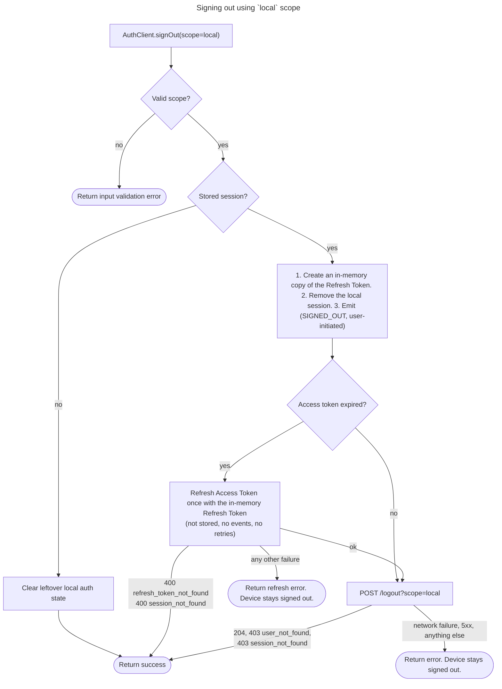
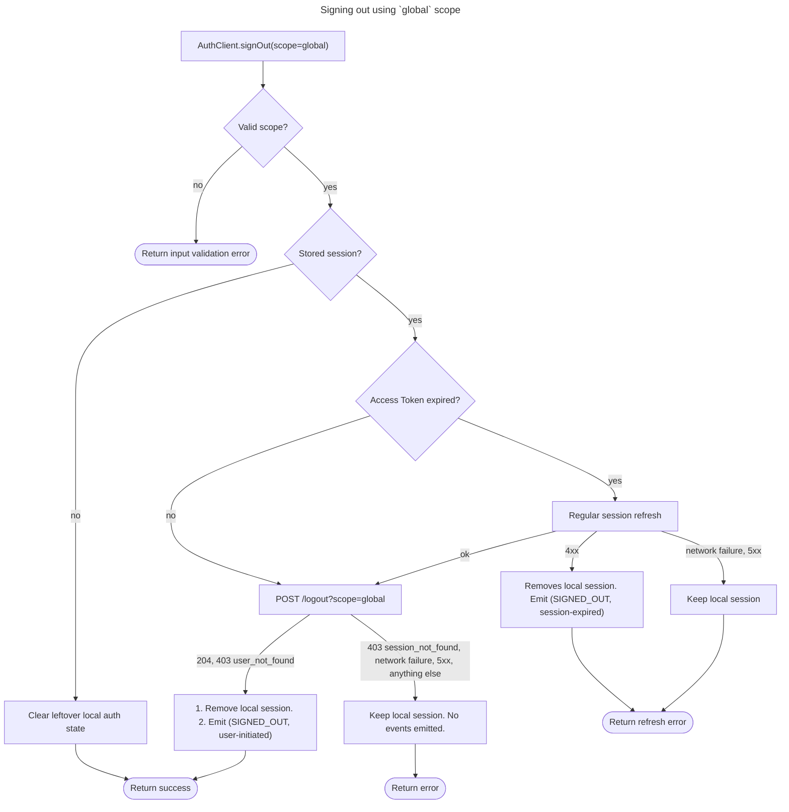
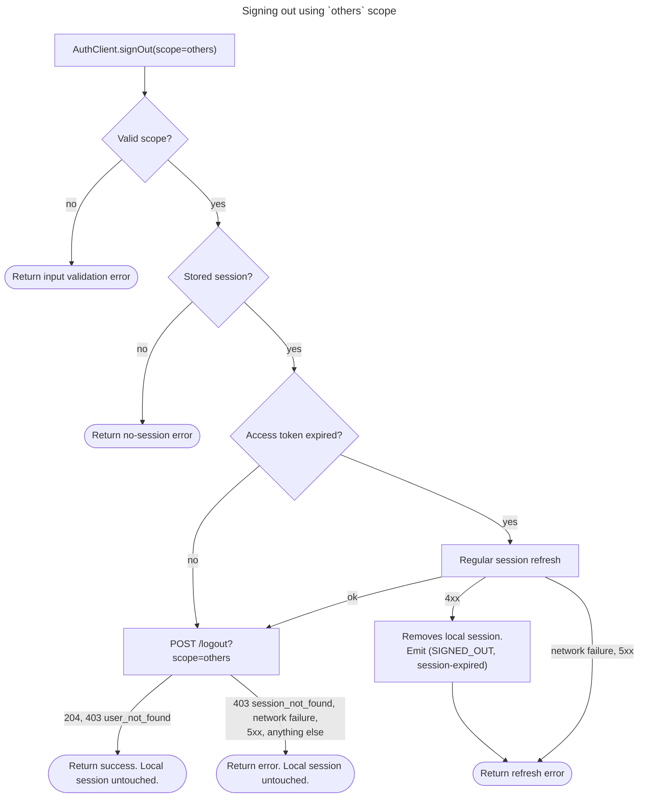

# Sign Out

End the user's sessions on the Auth server for a chosen scope and, when the
scope includes the current session, remove the locally stored session.

## API

Spec: [https://github.com/supabase/auth/blob/master/openapi.yaml](https://github.com/supabase/auth/blob/master/openapi.yaml)

- `POST /logout?scope={global|local|others}`

## Behavior

The input is a scope, one of `global`, `local`, or `others`. When the caller
supplies none, the SDK must define a default (see Notes). The SDK always sends
the `scope` query parameter and must not rely on the server default.

The flowchart under each scope below is the exact logic for that scope.

The request to sign out is authenticated with the current session's access
token as the bearer credential, so the server can identify the session the
scope is relative to. On success the server answers `204 No Content`, so the SDK
returns nothing beyond the absence of an error.

Sign-out ends refresh tokens, not access tokens. An access token already issued
for an ended session stays valid until its `exp` claim, and the SDK cannot make
it unusable elsewhere.

A sign-out event listener that throws should not stop the request to the server:
the SDK sends it and then handles listener's error as the SDK sees fit.

### How the scopes differ

The scopes differ in which server sessions they end, and in when, if ever, they
remove the local session. Already signed out follows the success column.

| Scope    | Server sessions ended                     | Local session on success | Local session on failure |
| -------- | ----------------------------------------- | ------------------------ | ------------------------ |
| `local`  | The current session                       | Removed                  | Removed                  |
| `global` | Every session of the user                 | Removed                  | Kept                     |
| `others` | Every session of the user except this one | Kept                     | Kept                     |

- `local` signs out the device first and asks the server second, so the device
  is signed out whatever the server answers.
- `global` asks the server first and signs out the device only once the server
  has ended the sessions.
- `others` never signs out the device, and needs the current session to
  authenticate, so with no stored session it fails instead of succeeding.

All three return the error on failure.

### `local`

Signs out this device and revokes the current session's refresh token on the
server. Signing out of the device never depends on the server: it happens
before any request, so the device is signed out whatever the server answers,
however long it takes to answer, and when it cannot be reached at all.

Removing the local session clears all auth state the SDK persists for the user:
the stored session, every stored PKCE code verifier, and any separately stored
copy of the user object. The removal emits the sign-out event through Subscribe
to Auth Events (`auth.session.subscribe_auth_events`), with the user-initiated
reason from [Sign-Out Reason](sign_out_reason.md) in SDKs that implement it.

The SDK emits the event exactly when it removes the local session, and never
twice for one sign-out. The access token the SDK held stays valid until its
`exp` claim; the SDK can only stop holding it.

SDKs that serialize session operations behind a lock run sign-out under that
lock, so a refresh in flight cannot write a new session back after sign-out has
removed it.

Removing the local session before the request also keeps the reason on the 
sign-out event correct. If the SDK refreshed an expired access token through 
Refresh Session first, a rejected refresh would remove the session with the 
session-expired reason, for a sign-out the user asked for. Instead, the SDK 
keeps the refresh token in memory and refreshes with it only to authenticate 
the revocation. That refresh must not store the new session, which would sign 
the device back in, and emits no events. A refresh answered 
`400 refresh_token_not_found` or `400 session_not_found` means the server has 
nothing left to revoke, for example because the session was revoked elsewhere, 
so the SDK treats it as already signed out.

When the revocation fails, the device stays signed out, but the refresh token
stays valid on the server until it expires or is revoked another way. The error
lets the app tell that the revocation did not happen.

### `global`

Ends every session of the user on the server, including this one, then signs
out this device.

When the stored access token has expired, the SDK refreshes it first through
Refresh Session (`auth.session.refresh_session`), the same refresh that runs
before any authenticated call. When the server rejects that refresh with a
`4xx`, Refresh Session has already removed the local session and emitted the
sign-out event with the session-expired reason by the time sign-out sees the
error. Sign-out only returns the error.

Removing the local session after a successful answer clears all auth state the
SDK persists for the user: the stored session, every stored PKCE code verifier,
and any separately stored copy of the user object. The removal emits the
sign-out event through Subscribe to Auth Events
(`auth.session.subscribe_auth_events`), with the user-initiated reason from
[Sign-Out Reason](sign_out_reason.md) in SDKs that implement it. The SDK emits
the event exactly when it removes the local session, and never twice for one
sign-out. The access token the SDK held stays valid until its `exp` claim; the
SDK can only stop holding it.

SDKs that serialize session operations behind a lock run sign-out under that
lock, so a refresh in flight cannot write a new session back after sign-out has
removed it.

On failure the SDK keeps the local session, so the user can retry or fall back
to `local`. Removing it would leave the client with no credentials with which
to end the other sessions.

### `others`

Ends every session of the user on the server except this one. Sign-out itself
never changes the local session for this scope, and so never emits the sign-out
event.

When the stored access token has expired, the SDK refreshes it first through
Refresh Session (`auth.session.refresh_session`), the same refresh that runs
before any authenticated call. When the server rejects that refresh with a
`4xx`, Refresh Session has already removed the local session and emitted the
sign-out event with the session-expired reason by the time sign-out sees the
error. Sign-out only returns the error. This is the only way this scope ends
with no local session.

With no stored session the SDK has no credential with which to revoke the other
sessions, so it returns its own no-session error instead of success.

## Errors

Besides `204`, some logout answers mean the server found nothing left to revoke
for the scope. The SDK treats these as already signed out and handles them
exactly like a `204`. Every other answer, and every network failure, is a
failure. The table lists how each answer lands per scope:

| Server answer                                    | `local`            | `global`           | `others`           |
| ------------------------------------------------ | ------------------ | ------------------ | ------------------ |
| `204`                                            | Success            | Success            | Success            |
| `403` `user_not_found`                           | Already signed out | Already signed out | Already signed out |
| `403` `session_not_found`                        | Already signed out | Failure            | Failure            |
| `403` `bad_jwt`, `403` `user_banned`             | Failure            | Failure            | Failure            |
| `400` `bad_jwt`, `401` `no_authorization`, `404` | Failure            | Failure            | Failure            |
| Any other `4xx` or `5xx`, or a network failure   | Failure            | Failure            | Failure            |

The reason for each row:

- `403` `user_not_found`: the user no longer exists, and neither do its
  sessions, so nothing is left to revoke for any scope.
- `403` `session_not_found`: the current session no longer exists, so nothing
  is left to revoke for `local`, but the other sessions that `global` and
  `others` end still do. The stored session is then unusable, so an app that
  gets this failure for `global` falls back to `local` to sign out the device.
- `403` `bad_jwt` (the access token is expired, its signature cannot be
  verified, or a claim is missing or malformed) and `403` `user_banned`: the
  server rejected the token before looking at any session, so every session
  still exists. A ban does not end sessions.
- `400` `bad_jwt`: the `sub` claim is not a UUID.
- `401` `no_authorization`: the request carried no bearer token.
- `404`: the Auth server never answers it on this endpoint, so it comes from
  something in front of the server.
- Any other `4xx` or `5xx`, including the `500` the server answers when it
  cannot end the sessions: the SDK returns the server's error.
- A network failure: the SDK returns its retryable network error, so the app
  can tell an unreachable server from a refusal and retry.

## Notes

- Auth servers before v2.145.0 send no `error_code` on this endpoint. They
  answer `401` for any token they cannot accept and `404` for a missing user,
  and do not check the session, so a missing session gets `204`. This spec
  does not support them: against such a server every `401` and `404` is a
  failure, including the `404` that means the user is already gone.
- Each SDK can define its own default scope. Auth uses `global`, so default to
  that unless there is a good reason to do otherwise.
- SDKs that hold no session (stateless server-side SDKs) implement this
  capability as the admin form, Admin Sign Out (`auth.admin.sign_out`), which
  takes the access token explicitly and keeps no local state to clear.

## Related

- [Sign-Out Reason](sign_out_reason.md): the reason carried on the sign-out
  event this capability emits.
- Subscribe to Auth Events (`auth.session.subscribe_auth_events`): the event
  stream the sign-out event is emitted on.
- Admin Sign Out (`auth.admin.sign_out`): the same server call with an
  explicitly supplied access token.
- Refresh Session (`auth.session.refresh_session`): runs before sign-out under
  `global` and `others` when the stored access token has expired.
