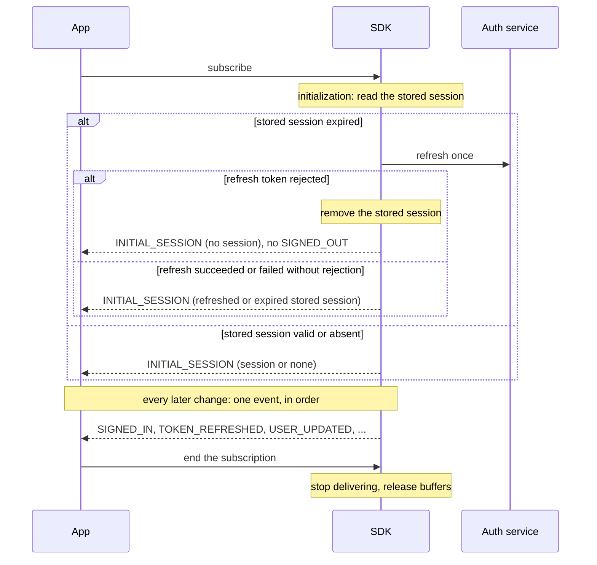
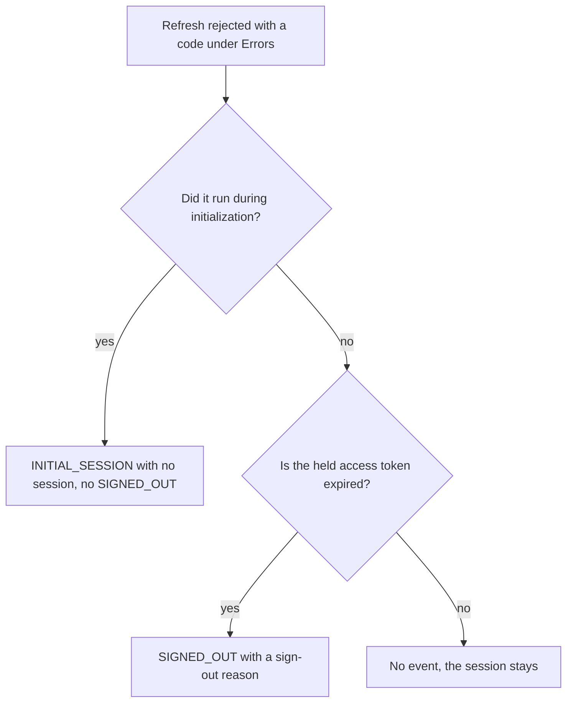

# Subscribe to Auth Events

Deliver every change of the client's auth state to the app, in the order the
client applied it, as an event together with the session the client holds after
the change.

This is a client-side capability. It makes no HTTP call of its own; the
operations listed below make the calls, and this file defines the event each one
produces.

## Behavior

### Events

The SDK defines these events, and no others:

- `INITIAL_SESSION`
- `SIGNED_IN`
- `SIGNED_OUT`
- `TOKEN_REFRESHED`
- `USER_UPDATED`
- `PASSWORD_RECOVERY`
- `MFA_CHALLENGE_VERIFIED`

An SDK spells and represents each event the way its language does: an enum, a
sealed type, a string constant, or a type of its own. It may expose the set as
closed, so that adding an event is a breaking change of the SDK, or as open. The
SDK does not define an event that no row of
[Event per operation](#event-per-operation) emits.

### Subscription

- A subscription receives every change the client applies after the subscribe
  call returns, whether or not the app has started reading from it. The SDK
  buffers changes for a subscription that has not read them yet and drops none.
- The first event of every subscription is `INITIAL_SESSION`, carrying the
  session the client holds, or no session. The SDK delivers it once client
  initialization has finished: the stored session has been read, and when it was
  expired, one refresh attempt has finished. A subscription created before
  initialization finishes receives `INITIAL_SESSION` when it finishes, before
  any other event.
- When that refresh attempt fails without a rejection of the refresh token (for
  example no network, or a 5xx answer), `INITIAL_SESSION` carries the expired
  stored session. When the server rejects the refresh token with one of the
  codes under [Errors](#errors), the SDK removes the stored session and
  `INITIAL_SESSION` carries no session. The SDK emits no `SIGNED_OUT` for that
  rejection: the subscription receives `INITIAL_SESSION` alone. The refresh rows
  of [Event per operation](#event-per-operation) apply only to refreshes that
  start after initialization finishes.
- When storage cannot be read yet (for example a device keychain before the
  first unlock), initialization has not finished, and the SDK delivers nothing
  until storage is read.
- After `INITIAL_SESSION`, each change the client applies produces exactly one
  event, in the order the client applied the changes. The SDK persists the new
  state before it delivers the event, so an app that reads the client's current
  session while handling an event reads the state that event describes.
- The session carried by an event is the one the client holds after the change.
  `SIGNED_OUT` carries no session.
- The SDK never delivers an error through a subscription. A failure that ends
  the session is delivered as `SIGNED_OUT`, with the reason defined in
  [Sign-Out Reason](sign_out_reason.md).
- When the app ends a subscription, the SDK stops delivering to it and releases
  what it holds for it. A subscription does not keep the client alive. When the
  client is released, every subscription ends.

### Event per operation

| Operation                                                                                                                                  | Event                                                                         |
| ------------------------------------------------------------------------------------------------------------------------------------------ | ----------------------------------------------------------------------------- |
| Subscribe                                                                                                                                  | `INITIAL_SESSION`, to the new subscription only, once initialization finishes |
| Sign up that returns a session                                                                                                             | `SIGNED_IN`                                                                   |
| Sign up that returns no session (confirmation required)                                                                                    | none                                                                          |
| Sign in with password, ID token, Web3, passkey, or anonymously                                                                             | `SIGNED_IN`                                                                   |
| Exchange a PKCE code for a flow the SDK started with a password reset request                                                              | `PASSWORD_RECOVERY`                                                           |
| Exchange a PKCE code for a flow the SDK started with an email change or link-identity request, for the user the client holds               | `USER_UPDATED`                                                                |
| Exchange a PKCE code for a flow the SDK started with an email change or link-identity request, while the client holds another user or none | `SIGNED_IN`                                                                   |
| Detect a session in a redirect URL whose `type` is `recovery`                                                                              | `PASSWORD_RECOVERY`                                                           |
| Detect a session in a redirect URL whose `type` is `email_change`, for the user the client holds                                           | `USER_UPDATED`                                                                |
| Detect a session in a redirect URL whose `type` is `email_change`, while the client holds another user or none                             | `SIGNED_IN`                                                                   |
| Exchange a PKCE code for any other flow, or detect a session in any other redirect URL                                                     | `SIGNED_IN`                                                                   |
| Verify an OTP of type `recovery`                                                                                                           | `PASSWORD_RECOVERY`                                                           |
| Verify an OTP of type `email_change` or `phone_change` that returns a session for the user the client holds                                | `USER_UPDATED`                                                                |
| Verify an OTP of type `email_change` or `phone_change` that returns a session while the client holds another user or none                  | `SIGNED_IN`                                                                   |
| Verify an OTP of any other type that returns a session                                                                                     | `SIGNED_IN`                                                                   |
| Verify an OTP that returns no session                                                                                                      | none                                                                          |
| Set a session from an access token and a refresh token                                                                                     | `SIGNED_IN`, once, even when setting it refreshed the session                 |
| A refresh, scheduled or on demand, that succeeds                                                                                           | `TOKEN_REFRESHED`                                                             |
| A refresh that fails without a rejection of the refresh token                                                                              | none                                                                          |
| A refresh rejected with a code under [Errors](#errors), while the held access token is still valid                                         | none                                                                          |
| A refresh rejected with a code under [Errors](#errors), while the held access token is expired                                             | `SIGNED_OUT`                                                                  |
| Update the user                                                                                                                            | `USER_UPDATED`                                                                |
| Link an identity with an ID token                                                                                                          | `USER_UPDATED`                                                                |
| Unlink an identity                                                                                                                         | `USER_UPDATED`, with the identity removed from the held session's user        |
| Verify an MFA challenge or an MFA recovery code                                                                                            | `MFA_CHALLENGE_VERIFIED`                                                      |
| Sign out with scope `global` or `local`                                                                                                    | `SIGNED_OUT`                                                                  |
| Sign out with scope `others`                                                                                                               | none                                                                          |

Detecting a session in a recovery redirect produces `PASSWORD_RECOVERY` alone,
not `SIGNED_IN` followed by `PASSWORD_RECOVERY`.

A PKCE redirect carries only a `code`, not a `type`. So when the SDK starts a
PKCE flow, it stores the flow's purpose with its code verifier, and the exchange
reads that purpose to choose the event.

The `200` answer to `DELETE /user/identities/{identity_id}` carries no user, so
the SDK removes the identity whose `identity_id` matches from the held session's
user. When no remaining identity uses that identity's provider, the SDK also
removes the provider from the user's `app_metadata.providers`. Then it persists
the session and emits `USER_UPDATED`. It does this only when the held session's
user is the identity's `user_id`; otherwise it emits nothing.

## Errors

- `refresh_token_not_found`, `refresh_token_already_used`, `session_expired`,
  `session_not_found`, `user_banned`, and an OAuth `invalid_grant` on
  `POST /token?grant_type=refresh_token`: the server rejected the refresh token.
  The SDK applies the refresh rows of the table above.
- `session_not_found` (`403`) on any call the SDK authorized with the held
  session's access token: the SDK removes that session and emits `SIGNED_OUT`,
  but only while it still holds the session the call used. A session signed in
  after the call went out stays.

## Related

- [Sign-Out Reason](sign_out_reason.md): the reason carried by `SIGNED_OUT`
- Sign Out (`auth.session.sign_out`): produces the `SIGNED_OUT` with a
  user-initiated reason
- Refresh Session (`auth.session.refresh_session`): produces `TOKEN_REFRESHED`,
  and `SIGNED_OUT` on a rejected expired session
