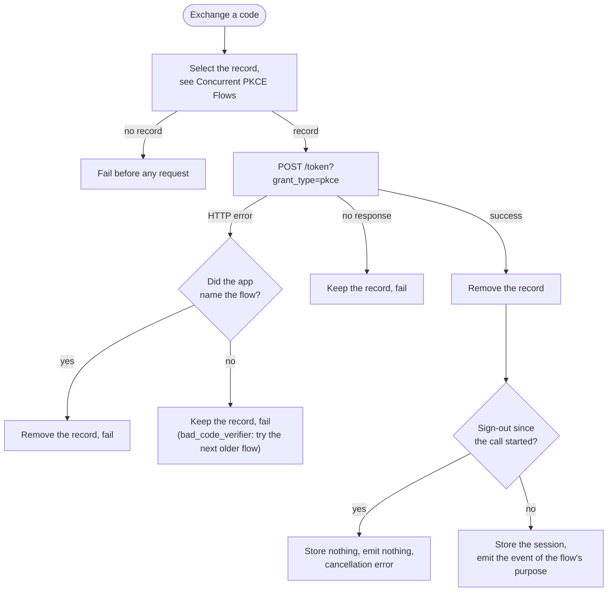

# Exchange Code for Session

Exchange the authorization code of a PKCE flow for a session, and store the session.

## API

Spec: [https://github.com/supabase/auth/blob/master/openapi.yaml](https://github.com/supabase/auth/blob/master/openapi.yaml)

- `POST /token?grant_type=pkce`

## Behavior

The input is the authorization code, which is the `code` parameter of a redirect URL, and an optional flow ID. The SDK finds the code verifier of the flow the code belongs to, sends it with the code, and returns the session.

### The verifier

The SDK reads the verifier from its pending flow records, not from the app. [Concurrent PKCE Flows](concurrent_pkce_flows.md) defines which record it uses: the record of the flow ID when the call has one, else the pending flows tried newest first. The SDK never sends a request without a verifier. When no record matches, the call fails before any request is sent, as that file defines under Errors.

SDKs that hold no pending flows (stateless server-side SDKs) take the verifier from the app and store nothing.

### After the answer

On success the SDK removes the record it used, then stores the session and emits one auth event. The purpose stored in the record chooses the event, because the redirect of a PKCE flow carries a code and no `type`: Subscribe to Auth Events (`auth.session.subscribe_auth_events`) lists the event for each purpose.

When a sign-out committed after the call started and before the session was stored, the SDK stores no session, emits no event, and fails the call with its cancellation error: the user signed out after the link was opened.

What the call does with the record on a failure depends on how the verifier was chosen:

| Failure                               | Record the app named by flow ID | Record the SDK chose |
| ------------------------------------- | ------------------------------- | -------------------- |
| The server answers with an HTTP error | removed                         | kept                 |
| No response arrives                   | kept                            | kept                 |

A record the SDK chose is kept on every failure, because a rejection does not show that the code belongs to that flow. The record expires on its own, as Concurrent PKCE Flows defines.

The outcomes after the SDK selects a record:

### Repeated calls

The call is not deduplicated. A second call with the same code sends a second request, and the server rejects it because the code is spent. A redirect URL that a platform can deliver more than once is handled through the SDK's redirect handling, which deduplicates it (see Session URL Detection, `client.authentication_integration.session_url_detection`).

## Errors

- No pending flow: the call fails with the SDK's own error before any request is sent, as [Concurrent PKCE Flows](concurrent_pkce_flows.md#errors) defines.
- `bad_code_verifier`: when the SDK chose the record, it tries the next older pending flow, and fails with the last such error when every record is rejected. When the app named the flow, the call fails with it.

## Related

- [Concurrent PKCE Flows](concurrent_pkce_flows.md): the records the verifier comes from, and how one is selected
- [Sign In with OAuth](sign_in_with_oauth.md): the call that starts the flow and ends in this one
- Session URL Detection (`client.authentication_integration.session_url_detection`): the redirect handling that calls this exchange for a code
