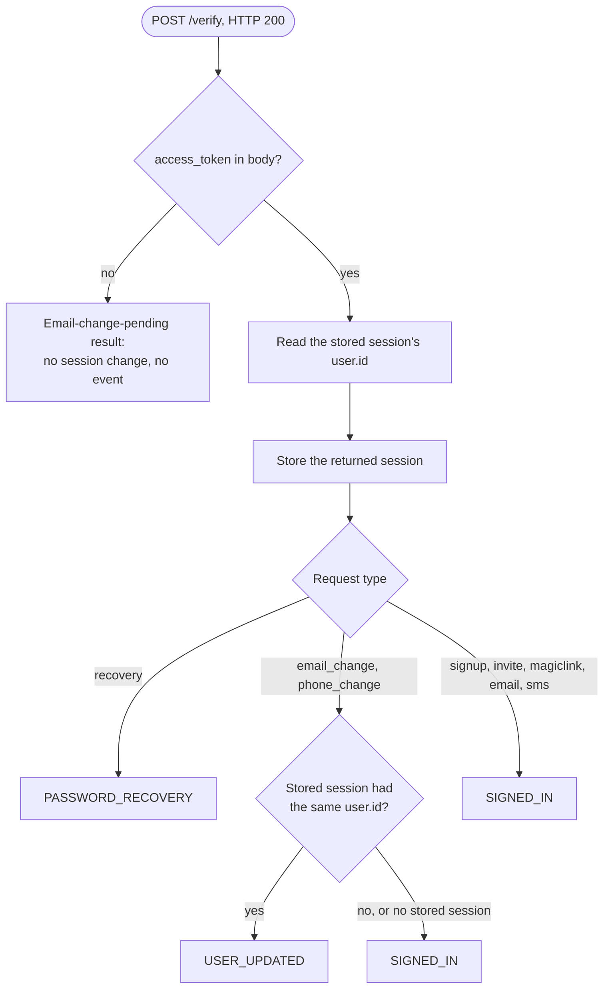

# Verify OTP

Verify a one-time code sent to an email address or a phone number, or the token hash from an email link. On success the SDK stores the session the server returns, except for the first confirmation of a secure email change, which returns no session.

## API

Spec: [https://github.com/supabase/auth/blob/master/openapi.yaml](https://github.com/supabase/auth/blob/master/openapi.yaml)

- `POST /verify`

`GET /verify` is the link in an email, which the user's browser opens. The SDK does not call it.

The OpenAPI entry for `POST /verify` omits the type `email` from the `type` enum, documents `redirect_to` in the body, and documents a session as the only 200 body. The handler accepts `email` ([`verifyUserAndToken`](https://github.com/supabase/auth/blob/a7e97d665b9ea03853edb66d014bcde323f7894b/internal/api/verify.go#L746-L757)), ignores `redirect_to` on `POST` and rejects it next to a `token_hash` ([`Validate`](https://github.com/supabase/auth/blob/a7e97d665b9ea03853edb66d014bcde323f7894b/internal/api/verify.go#L83-L87)), and answers the first confirmation of a secure email change with `{"msg": ..., "code": "200"}` ([`verifyPost`](https://github.com/supabase/auth/blob/a7e97d665b9ea03853edb66d014bcde323f7894b/internal/api/verify.go#L293-L298)).

<!-- Delete the paragraph above once supabase/auth corrects the POST /verify entry.
     No upstream issue is filed yet. -->

## Behavior

### Request

The SDK's request type admits three forms, and no other combination:

| Form | Body |
|---|---|
| Email code | `email`, `token`, and an email type |
| Phone code | `phone`, `token`, and a phone type |
| Token hash | `token_hash` and an email type, with no `email`, `phone`, or `redirect_to` |

The email types are `signup`, `invite`, `magiclink`, `recovery`, `email_change`, and `email`. The phone types are `sms` and `phone_change`. The request type keeps the two sets apart, so a phone type cannot travel with an email address or a token hash, and an email type cannot travel with a phone number. The server does not reject a mixed request for what it is: it looks the user up by the identifier the type implies, finds none, and answers HTTP 403 with error code `otp_expired` and the message `Token has expired or is invalid`, which a caller would read as a wrong code.

`email` is the type for a code whose purpose the caller does not know. The server matches it against the user's sign-up confirmation code and then against the magic link code.

The SDK sends no `redirect_to`, in the body or the query: on `POST` the server never redirects, and a `redirect_to` next to a `token_hash` fails the request. The SDK sends no captcha token either, because the server does not check one on this route ([routes](https://github.com/supabase/auth/blob/a7e97d665b9ea03853edb66d014bcde323f7894b/internal/api/api.go#L270-L273)).

### Response

A 200 body is one of two shapes, and the SDK tells them apart by `access_token`:

1. `access_token` is present: the body is a session with its user. The SDK stores it, replacing any stored session, and returns it.
2. `access_token` is absent and `msg` is present: the server accepted the first of the two confirmations of a secure email change and waits for the second. Only the type `email_change` gets this body. The SDK returns an email-change-pending result that carries `msg`. It does not change the stored session, emits no event, and does not treat the body as an error or as a sign-in.

The SDK's result type has a case for each shape, so a caller cannot read a pending email change as a session.

### Auth event

After it stores a session, the SDK emits one auth event, decided by the type of the request and, for a contact change, by whose session it replaced:

| Type | Event |
|---|---|
| `recovery` | `PASSWORD_RECOVERY` |
| `email_change`, `phone_change`, and the stored session belonged to the same user | `USER_UPDATED` |
| `email_change`, `phone_change`, and no session was stored or it belonged to another user | `SIGNED_IN` |
| `signup`, `invite`, `magiclink`, `email`, `sms` | `SIGNED_IN` |

The same user means that the `user.id` of the returned session equals the `user.id` of the session that was stored when the response arrived. The SDK reads the stored session before it replaces it. A contact change confirmed with no session stored, such as on another device, or while another user is signed in, starts a new sign-in on this client, so it emits `SIGNED_IN`. The email-change-pending result emits no event.

The call does not clear the stored session before the request. A request that fails leaves the stored session as it was.

## Errors

- `token` and `token_hash` together, or neither: the request type does not admit them. An SDK whose language cannot express that raises its own argument error before any request is sent, which pre-empts HTTP 400 with error code `validation_failed` and the message `Verify requires either a token or a token hash`.
- `token_hash` with `email`, `phone`, or `redirect_to`: the request type does not admit it. The server answers HTTP 400 with error code `validation_failed` and the message `Only the token_hash and type should be provided`.
- `token_hash` with a phone type: the request type does not admit it. The server answers HTTP 400 with error code `validation_failed` and the message `Invalid email verification type`.
- `otp_expired` (HTTP 403): the code or link is wrong, used, or expired. The SDK surfaces it as is and does not retry.

## Related

- [Sign In with OTP](sign_in_with_otp.md): sends the code for `email`, `magiclink`, `signup`, and `sms`
- [Sign Up](sign_up.md): sends the code for `signup` and `sms` when confirmation is on
- [Resend Confirmation](resend_confirmation.md): sends a new code for `signup`, `email_change`, `sms`, and `phone_change`
- [Send Password Reset Email](send_password_reset_email.md): sends the code for `recovery`
- Session URL Detection (`client.authentication_integration.session_url_detection`): the same confirmations when they arrive as a redirect
- Update User (`auth.session.update_user`): sends the code for `email_change` and `phone_change`
- Subscribe to Auth Events (`auth.session.subscribe_auth_events`): where the events above arrive
