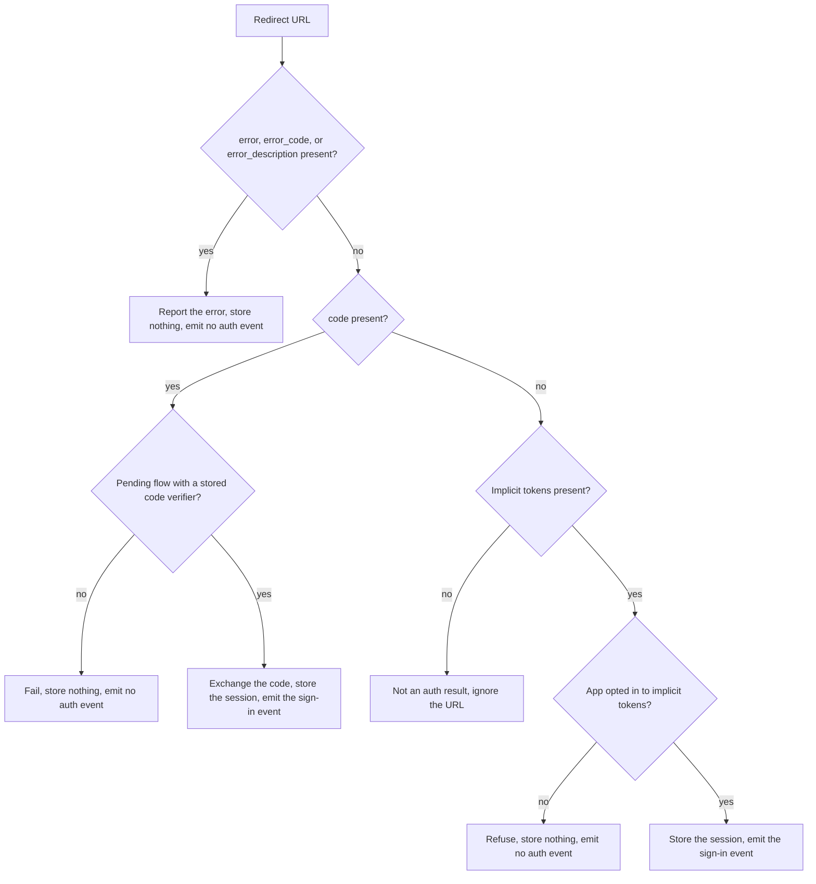

# OAuth Redirect Detection

Read an auth result from the redirect URL the Auth server sends the browser back
to after OAuth sign-in, a magic link, signup confirmation, recovery, invite, or
an email change, and turn it into a stored session, without the application
parsing the URL itself.

## API

Spec:
[https://github.com/supabase/auth/blob/master/openapi.yaml](https://github.com/supabase/auth/blob/master/openapi.yaml)

- `POST /token?grant_type=pkce`: exchanges the `code` from a PKCE redirect, with
  the stored code verifier

## Behavior

A redirect URL carries one of three results. The SDK reads them from the query
string, and for the implicit shape from the fragment:

| Shape    | Where it arrives                                                                                          | What the SDK does                                                           |
| -------- | --------------------------------------------------------------------------------------------------------- | --------------------------------------------------------------------------- |
| Error    | `error`, `error_code`, `error_description` in the query or the fragment                                   | Reports the error. Stores nothing.                                          |
| PKCE     | `code` in the query                                                                                       | Exchanges the code with the stored code verifier and stores the session.    |
| Implicit | `access_token`, `refresh_token`, `expires_in`, `token_type=bearer` in the fragment, and optionally `type` | Stores the session from the tokens, only when the app opted in (see below). |

The optional `type` is one of `recovery`, `invite`, `signup`, `magiclink`, or
`email_change`. The SDK reports it to the app with the session, so the app can
route a recovery link to a password form.

The SDK decides in this order. The first matching step ends the decision:

### Implicit tokens need an explicit opt-in

An implicit URL signs the app in to whatever account its tokens belong to. No
pending flow on this device has to exist. Anyone who can make the app open such
a URL, for example through a deep link or a page the user visits, can sign the
user in to the attacker's account. The user then saves data into that account
(login CSRF).

An SDK therefore accepts implicit tokens from a URL only when the app has
explicitly chosen the implicit flow:

- An SDK that lets the app choose the flow type accepts implicit tokens only
  when the app chose the implicit flow. When the app chose the PKCE flow, the
  SDK refuses an implicit URL.
- An SDK that has no flow type option and always signs in with PKCE refuses
  implicit URLs by default. It may offer an explicit opt-in that is off unless
  the app turns it on.

A refused URL stores no session and emits no auth event. The call that read the
URL reports an error.

### PKCE codes need a pending flow

A PKCE `code` is usable only on the device that started the flow, because the
code verifier is stored there. A URL with a `code` and no matching stored code
verifier fails with an error. It stores no session and emits no auth event. The
SDK does not retry the exchange without a verifier.

### Error URLs

When the URL carries any of `error`, `error_code`, or `error_description`, the
SDK reports an error that carries all three values the URL held, and goes no
further, whatever else the URL carries. It stores no session and emits no auth
event. It does not remove a session that already exists, so a reused magic link
does not sign out a signed-in user.

### Browser sessions the SDK presents

When the SDK itself presents the browser for an OAuth sign-in and the app gave a
redirect URL, the callback URL the browser returns must match that redirect URL
before the SDK reads any result from it. A match means the same scheme, host,
port, and path. The query string and the fragment are ignored in the comparison.
A callback that does not match fails with an error and stores nothing, and the
SDK does not run the decision above on it.

## Errors

- A URL with `error`, `error_code`, or `error_description`: the SDK reports an
  error carrying those values. It makes no call to `/token`.
- An implicit URL the SDK refuses: the SDK reports an error and sends no request
  that carries the tokens in the URL.
- A `code` with no stored code verifier: the SDK reports an error and makes no
  call to `POST /token?grant_type=pkce`.
- A browser callback that does not match the app's redirect URL: the SDK reports
  an error before it reads the callback.

## Related

- OAuth Flow Type Selection
  (`client.authentication_integration.oauth_flow_type`): the app's choice
  between implicit and PKCE, which decides whether implicit tokens count as
  opted in
- [Cross-Client Token Synchronization](cross_client_token_sync.md): a stored
  session from a redirect reaches every sub-client through the same propagation
  as any other sign-in
