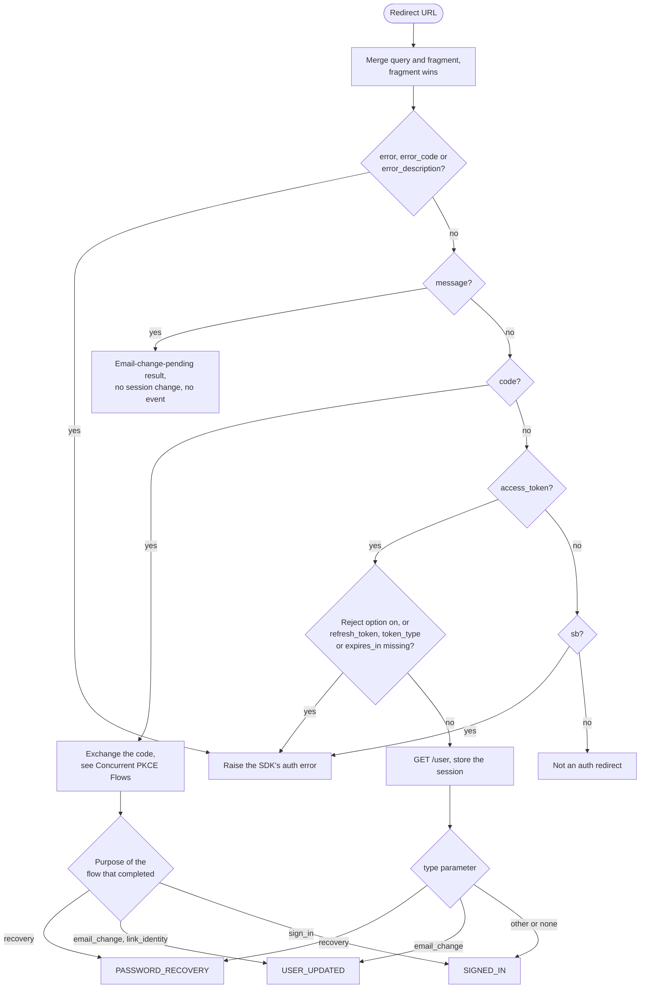
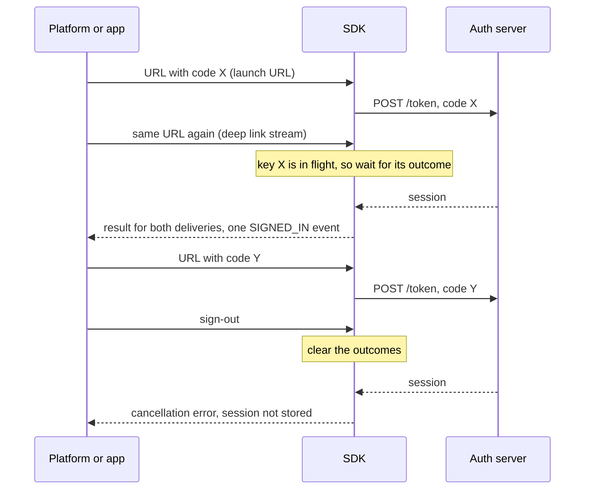

# Session URL Detection

## API

Spec: [https://github.com/supabase/auth/blob/master/openapi.yaml](https://github.com/supabase/auth/blob/master/openapi.yaml)

- `POST /token?grant_type=pkce` - exchanges a code from the redirect
- `GET /user` - fetches the user for tokens from the redirect

The API spec does not describe the parameters the server adds to a redirect URL. The handlers that write them are [`prepRedirectURL` and `prepErrorRedirectURL`](https://github.com/supabase/auth/blob/a7e97d665b9ea03853edb66d014bcde323f7894b/internal/api/verify.go#L491-L538).

## Behavior

A redirect URL reaches the SDK in one of two ways, and both run the steps below:

- SDKs that receive the URL themselves, from the page's own URL in a browser or from the platform's deep link listener, handle it when detection is on. Detection is configured with a boolean or a predicate. The predicate gets the URL and replaces the default test for an auth redirect, so an app that also receives callbacks from other OAuth clients can tell them apart.
- Every SDK that holds a session exposes a call that takes a URL. It returns the result, or an answer that the URL is not an auth redirect.

The SDK reads the query and the fragment as one set of parameters. When a key is in both, the fragment's value wins.

The SDK finds the flow from the URL's contents, never from a configured flow type. The first matching row applies:

1. `error`, `error_code`, or `error_description` is present: the redirect reports an error, as defined under Errors.
2. `message` is present: the server accepted the first of the two confirmation links of an email change and waits for the second. The SDK returns an email-change-pending result that carries the message. It changes no session, emits no event, and is not an error.
3. `code` is present: the SDK exchanges the code as defined in [Concurrent PKCE Flows](../../auth/sign_in/concurrent_pkce_flows.md), with the `sb_flow_id` parameter as the flow ID when present.
4. `access_token` is present: the redirect carries implicit tokens. The SDK requires `refresh_token`, `token_type`, and `expires_in` as well, fetches the user with the access token, and stores the session.
5. `sb` is present: the server marks its redirects with this empty parameter, so a URL with the marker and no result is an error.
6. Otherwise the URL is not an auth redirect. The call says so, and detection leaves the URL alone.

The rows, with the event each result emits:

The default test for an auth redirect is that row 1 to 5 matches. A bare `code` matches it, which is why the predicate exists.

The SDK accepts implicit tokens in row 4 even when it starts every flow with PKCE, because the server sends tokens in the fragment for a link that started without a code challenge, such as an invite or a link generated through the admin API ([handler](https://github.com/supabase/auth/blob/a7e97d665b9ea03853edb66d014bcde323f7894b/internal/api/verify.go#L135-L138)). The SDK offers an option that rejects them, as defined under Errors.

After it stores the session, the SDK emits one auth event:

- For a code, the purpose of the pending flow that completed decides the event: `recovery` emits `PASSWORD_RECOVERY`, `email_change` and `link_identity` emit `USER_UPDATED`, and `sign_in` emits `SIGNED_IN`.
- For implicit tokens, the `type` parameter decides the event: `recovery` emits `PASSWORD_RECOVERY`, `email_change` emits `USER_UPDATED`, and any other value, or none, emits `SIGNED_IN`.

A platform can deliver the same URL more than once, for example as the launch URL and again on the deep link stream. The SDK keeps the outcome of at least the 8 most recent redirects that carried a code or an access token, keyed by that value. A second delivery with the same key, while the first is in flight or after it ended, returns the first delivery's result or error. It sends no request and emits no event. To retry a code after a failure, the app calls the code exchange itself.

A sign-out clears those outcomes, so a URL delivered after a sign-out is handled again. A redirect that started before a sign-out and finishes after it does not store its session, and fails with the SDK's cancellation error: the user signed out after the link was opened. A sign-out that keeps the local session, such as one scoped to other sessions, does neither.

A duplicate delivery while the first is in flight, and a sign-out that overtakes a redirect:

SDKs that read the page's own URL remove the parameters they read from it after a successful result, so a reload does not deliver the redirect again.

## Errors

- Error redirect: the SDK raises its auth error. The error code is `error_code` when present. The message is `error_description`, else `error`. The SDK removes no pending flow and keeps the current session.
- Incomplete tokens: an `access_token` without `refresh_token`, `token_type`, or `expires_in` raises the SDK's auth error, and no request is sent.
- Implicit tokens rejected: when the app turned on the option that rejects implicit tokens, row 4 raises the SDK's auth error, and no request is sent.
- Marker without a result: row 5 raises the SDK's auth error.
- Code exchange: the errors of [Concurrent PKCE Flows](../../auth/sign_in/concurrent_pkce_flows.md#errors) apply.

## Notes

- Implicit tokens carry a login cross-site request forgery risk. Any URL that holds a valid token pair signs the app in as that pair's user, so an attacker who gets the app to open a link with the attacker's own tokens signs the victim in to the attacker's account. A code is safe from this, because its verifier never leaves the device that started the flow. An app that sends no invites and generates no links through the admin API turns on the option that rejects implicit tokens.
- Stateless server-side SDKs hold no session and no pending flows, so this capability is `not_applicable` to them. They exchange a code with a verifier the app supplies.

## Related

- [Concurrent PKCE Flows](../../auth/sign_in/concurrent_pkce_flows.md): stores the pending flows that a code completes
- OAuth Flow Type Selection (`client.authentication_integration.oauth_flow_type`): the configured flow type, which this feature does not read
- Subscribe to Auth Events (`auth.session.subscribe_auth_events`): where the events above arrive
