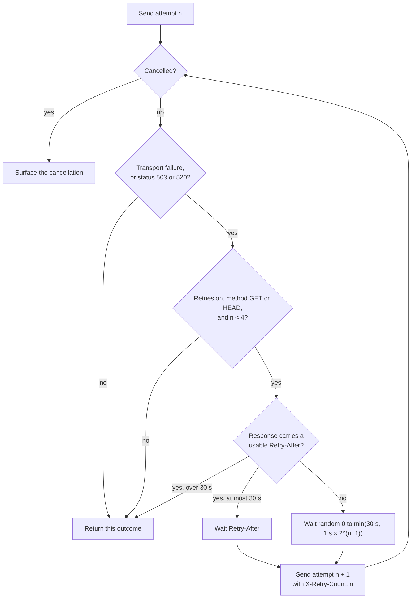

# Automatic Retry with Backoff

## API

Spec:
[PostgREST Documentation: API](https://docs.postgrest.org/en/stable/references/api.html)

This feature has no endpoint of its own. The SDK sends the same PostgREST
request again.

## Behavior

The rule for which requests retry is fixed. The caller can switch retries on or
off, and can do nothing else: the methods, the statuses, the attempt limit, and
the delays below are not configurable.

### Which requests retry

A request is retried only when all three of these hold:

- Retries are on for it. A per-client switch, on by default, sets this for every
  request the client sends. A per-request override replaces the switch for one
  request, in either direction: it turns retries on for one request on a client
  that has them off, and off for one request on a client that has them on.
- Its method is `GET` or `HEAD`. The method decides, not the operation: a
  function call sent as `GET` retries, and the same call sent as `POST` does
  not. No other method is sent twice, because a write can take effect twice and
  PostgREST takes no idempotency key.
- The attempt failed transiently. Either the HTTP client reported a network
  failure before a response arrived (no connection, a dropped connection, or the
  timeout of a single attempt), or the response status is `503` or `520`. Every
  other status, `500` included, is the database's answer, and the SDK returns it
  as it is.

### Attempts

A request gets at most 4 attempts, the first included, so at most 3 retries.
When the last allowed attempt fails, its response or its network error is the
request's outcome. Retrying adds no error of its own.

The n-th retry carries the header `X-Retry-Count: n`, so the first retry sends
`X-Retry-Count: 1`. The first attempt carries no such header.

The SDK discards the body of a response it retries. The caller never sees a
response that a later attempt replaced.

### Delay

Before the n-th retry the SDK waits a uniformly random duration in the closed
range from 0 to `min(30 s, 1 s × 2^(n−1))`, which gives upper bounds of 1 s, 2
s, and 4 s. Each wait draws a new random value. The jitter is required: without
it, every client that lost the same connection retries at the same instant.

When a retryable response carries a `Retry-After` header
([RFC 9110, section 10.2.3](https://www.rfc-editor.org/rfc/rfc9110.html#section-10.2.3)),
the SDK reads it as delta-seconds (a non-negative integer) or as an HTTP-date,
and then:

- A value from 1 s to 30 s: the SDK waits exactly that long, with no jitter.
- A value over 30 s: the SDK does not retry, and this response is the request's
  outcome. A shorter wait would spend an attempt on a request the server said
  would fail, and a longer wait would break the 30 s bound on any one wait.
- A value of 0, a date that has passed, or a value the SDK cannot parse: the
  jittered delay above applies. Such a value carries no usable time, and a zero
  wait would make every client that got it retry at the same instant.

A network failure has no `Retry-After`, so the jittered delay always applies to
it.

### What is never retried

- Cancellation. When the caller cancels the request during an attempt or during
  a wait, the SDK stops at once and surfaces the cancellation. It sends no
  further attempt. A timeout the caller set for the whole request is a
  cancellation, not the timeout of a single attempt.
- Errors from caller-supplied code. An error thrown by an access-token callback,
  a request or response interceptor, or any other hook the caller supplies is
  not a network failure. It propagates unchanged and is not retried. A custom
  HTTP client that the caller supplies is the transport: its network failures
  retry like those of the default client.
- Decoding. Only the send is retried. A response that the SDK cannot decode is
  not retried, and the decoding error is the outcome.

## Related

- [Per-Request Access Token](access_token.md): a re-send after a `401` may share
  this attempt limit
- [Automatic Retry](../../storage/configuration/auto_retry.md): the Storage
  counterpart, with its own statuses and a configurable attempt count
