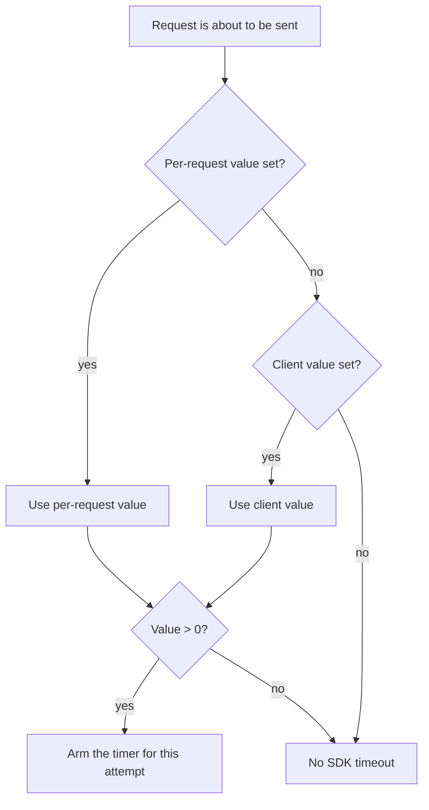
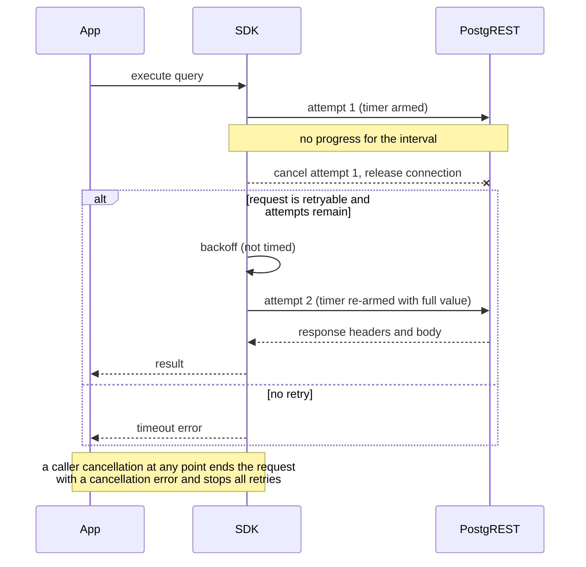

# Request Timeout

Bound how long one database request may wait on the network. A request that
exceeds the bound is cancelled, its connection is released, and it fails with a
timeout error instead of hanging.

## Behavior

### Setting the timeout

The caller sets a timeout when the client is constructed. It applies to every
request that client sends. Where the SDK offers a per-request override, the
per-request value wins for that one request, and it changes no other request and
no other client.

The value uses the language's duration type. A language without one takes a
number in the unit that its standard library timers take, and the SDK documents
that unit.

A value of zero or less is treated as unset: the request has no SDK timeout. It
never means "fail immediately", and it is not an argument error.

When the caller sets no value, the SDK applies no timeout of its own. A default
limit that the underlying HTTP stack applies on its own stays in effect, and the
SDK documents that limit. The SDK does not set a default value in the HTTP stack
for the caller.

### What the timeout measures

The SDK implements one of two forms and documents which:

- **Deadline.** The timer starts when the attempt is sent and stops when the
  response body has been read in full.
- **Idle.** The timer restarts each time a chunk of the request body is sent,
  the response headers arrive, or a chunk of the response body arrives. It fires
  once no such progress happens for the whole interval.

In both forms the bound covers the response body, not only the headers. A
request whose headers arrive in time but whose body stalls still times out.

When the timer fires, the SDK cancels the in-flight request so that the
connection is released, and the request fails with the timeout error described
under [Errors](#errors).

### Interaction with retries

The timeout bounds each attempt separately, never the sum of all attempts. Every
attempt that `database.configuration.auto_retry` sends gets the full value, and
the backoff wait between attempts is not counted against it. A timed-out attempt
is a transport failure, so it is retried under the same rules as any other
transport failure.

A caller who needs one bound across all attempts, backoff included, uses
caller-initiated cancellation (`database.using_modifiers.request_cancellation`)
on a timer of their own.

### Interaction with cancellation

Caller-initiated cancellation and the timeout run side by side. Whichever fires
first ends the attempt, and neither turns the other off. A caller cancellation
also stops any retry that would follow, while a timeout does not.

## Errors

- **Timeout.** When the timer fires on the last attempt, the request fails with
  the SDK's transport-error type, never with the error type that carries a
  PostgREST response. The error is marked as a timeout, so the caller can tell
  it apart from every other transport failure, and it keeps the platform's own
  timeout error as its cause where the platform raises one.
- **Caller cancellation.** A request that the caller cancels fails with the
  platform's cancellation error, never with the timeout error. The two are
  distinct even when the platform uses the same mechanism to abort both.

## Related

- `database.configuration.auto_retry`: a timed-out attempt is retried like any
  other transport failure.
- `database.using_modifiers.request_cancellation`: caller-initiated
  cancellation, which runs side by side with the timeout and is the way to bound
  all attempts together.
- `functions.invocation.timeout`: the same knob for Edge Function invocations.
