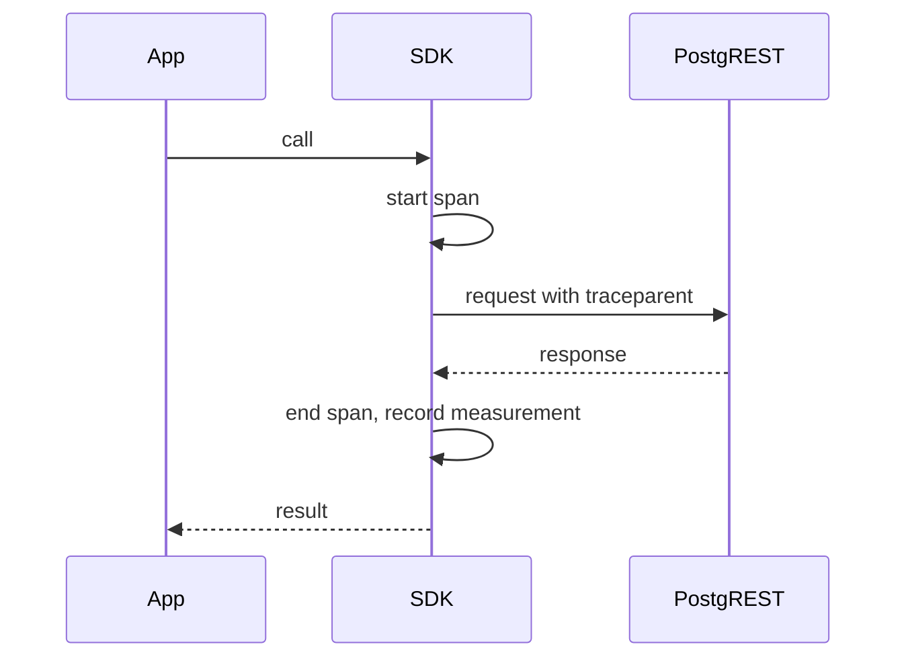

# Client Spans and Request Duration Metric

With OpenTelemetry enabled, the SDK emits one client span and one
`http.client.request.duration` measurement per PostgREST call.

## API

Spans follow the OpenTelemetry
[HTTP client span](https://opentelemetry.io/docs/specs/semconv/http/http-spans/#http-client-span)
conventions. The measurement follows the OpenTelemetry
[`http.client.request.duration`](https://opentelemetry.io/docs/specs/semconv/http/http-metrics/#metric-httpclientrequestduration)
conventions. This file defines what the SDK adds to them.

## Behavior

The scope is PostgREST calls. Only spans and measurements the SDK itself emits
are covered. Spans from the app's own HTTP instrumentation are not.

How emission is enabled (built in, an opt-in package, or a hook) follows the
idiom of each language. The span and metric contract below is the same for every
SDK. When the app has no OpenTelemetry provider configured, the SDK records
nothing.

### One call, one span

Each PostgREST call emits one span of kind client and one
`http.client.request.duration` measurement. This holds when the SDK retries the
request: the span covers all attempts, and the measurement is the duration of
the whole call, from the start of the first attempt to the end of the last.

When the span records, the propagated trace context (`traceparent`, see
`client.observability.trace_propagation`) names this span as the parent of the
server-side spans.

When the span does not record (for example, the app has no tracer provider, or
its sampler drops the span), the propagated trace context is the app's own
active span, or none. A span that does not record can carry new IDs with the
sampled flag off, and a server that samples by its parent would then drop its
own spans.

The tracer and the meter both have the instrumentation scope name
`supabase.postgrest`.

The span name is `{method} {path}`, where `{method}` is the HTTP request method
and `{path}` is the path of the request URL without the query string:

- `GET /rest/v1/users`
- `POST /rest/v1/rpc/get_scores`

### Supabase attributes

The span and the measurement carry these attributes:

| Attribute                      | When        | Value                                                      |
| ------------------------------ | ----------- | ---------------------------------------------------------- |
| `supabase.postgrest.operation` | Always      | `select`, `insert`, `update`, `upsert`, `delete`, or `rpc` |
| `supabase.postgrest.table`     | Table calls | The table or view name, for example `users`                |
| `supabase.postgrest.function`  | RPC calls   | The function name, for example `get_scores`                |

The operation is derived from the request, in this order:

1. A request to the path `rpc/{fn}` is `rpc`, whatever the method. The function
   attribute is `{fn}`.
2. Otherwise `GET` and `HEAD` are `select`. A `HEAD` request is a count-only
   select.
3. `POST` with a `resolution=` preference in the `Prefer` header is `upsert`.
4. Any other `POST` is `insert`.
5. `PATCH` is `update`.
6. `DELETE` is `delete`.

For every operation except `rpc`, the table attribute is the table or view name
the call targets.

### Span attributes and status

| Attribute                   | When               | Value                                                                                          |
| --------------------------- | ------------------ | ---------------------------------------------------------------------------------------------- |
| `http.request.method`       | Always             | The HTTP request method                                                                        |
| `url.full`                  | Always             | The request URL, redacted as defined below                                                     |
| `server.address`            | Always             | The host of the request URL                                                                    |
| `server.port`               | Always             | The port of the request URL                                                                    |
| `http.response.status_code` | A response arrives | The HTTP status code of the final response                                                     |
| `error.type`                | The call fails     | The status code as a string for status >= 400, otherwise a low-cardinality name of the failure |

The span status is Error when the response status is >= 400 or when no response
arrives. Otherwise the span status is left unset.

### URL redaction

`url.full` never carries a query value, user info, or fragment:

- Every query value is replaced by `REDACTED`. The keys are kept.
- The values of the keys `select`, `order`, `limit`, and `offset` are kept as
  sent. The match is exact and case-sensitive on the whole key, so an embedded
  key such as `posts.order` is redacted.
- On an `rpc` call, every query value is redacted, the four keys above included.
  The query of a `GET` or `HEAD` RPC call carries the function's arguments.
- A repeated key is redacted at each occurrence.
- User info and fragment are dropped.
- Keys and kept values appear in their percent-encoded wire form.

Before:

```
https://example.supabase.co/rest/v1/users?select=id%2Cemail&email=eq.john@doe.com&order=created_at.desc&limit=10
```

After:

```
https://example.supabase.co/rest/v1/users?select=id%2Cemail&email=REDACTED&order=created_at.desc&limit=10
```

### Request duration metric

The measurement is `http.client.request.duration`, in seconds, recorded from the
`supabase.postgrest` meter. Its attributes are:

| Attribute                   | When               | Value                                      |
| --------------------------- | ------------------ | ------------------------------------------ |
| `http.request.method`       | Always             | The HTTP request method                    |
| `server.address`            | Always             | The host of the request URL                |
| `server.port`               | Always             | The port of the request URL                |
| `url.scheme`                | Always             | The scheme of the request URL              |
| `http.response.status_code` | A response arrives | The HTTP status code of the final response |
| `error.type`                | The call fails     | Same value as on the span                  |

The measurement also carries the Supabase attributes. It does not carry
`url.full`.



## Errors

A call the SDK rejects before it sends anything sends no request. It emits
neither a span nor a measurement.

## Related

- Distributed Trace Context Propagation
  (`client.observability.trace_propagation`): carries the `traceparent` header
  that names this span as the parent of server-side spans
- [Diagnostic Logging](../../client/observability/diagnostic_logging.md):
  reports the SDK's internal decisions, while this capability reports each call
  as a span and a measurement
