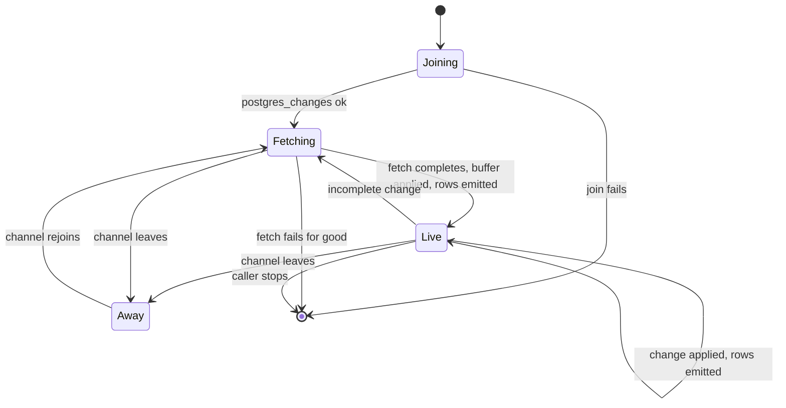

# Stream Rows (Live Query)

## API

This feature makes no request of its own. It combines two operations:

- Read the rows:
  [`GET /{table}`](https://docs.postgrest.org/en/stable/references/api/tables_views.html)
  on PostgREST, as Select Rows (`database.query.select`) does.
- Receive the changes: a `postgres_changes` binding on a Realtime channel, as in
  [Subscribe to a Channel](../../realtime/channel/subscribe.md). The
  [Realtime protocol](https://supabase.com/docs/guides/realtime/protocol)
  defines the join and the change payload.

## Behavior

The caller names a table, its primary key columns, and an optional filter. The
SDK returns a stream. Each element of the stream is the full current result set:
every row of the table that matches the filter, as of the last change the SDK
applied. The stream starts when the caller starts to consume it, and it ends
when the caller stops.

### Channel

Each stream opens a Realtime channel of its own, on a topic no other channel of
the client uses, so that a rejoin or a failure of one stream does not affect
another. The channel carries:

- one `postgres_changes` binding with event `*`, the table's schema and name,
  and the filter, when there is one
- when there is a filter, one more binding with event `DELETE`, the same schema
  and table, and no filter, because
  [Realtime cannot filter deletes](https://supabase.com/docs/guides/realtime/postgres-changes#delete-events-are-not-filterable)

When the stream ends, for any reason, the SDK removes the channel.

### Order of operations

The SDK subscribes first and fetches second, so that no change committed between
the two is lost:

1. The SDK joins the channel.
2. It waits until the server reports the `postgres_changes` bindings live: the
   `system` message with extension `postgres_changes` and status `ok`.
3. It fetches the rows.
4. Changes that arrive while the fetch runs wait in a buffer, in the order they
   arrive. When the fetch completes, the SDK takes the fetched rows as the
   result set, applies the buffered changes on top of it in order, clears the
   buffer, and emits the result set.
5. After that, it applies each change as it arrives and emits the result set
   after each change that alters it. A change that alters nothing, such as the
   delete of a row the stream does not hold, emits nothing.

### Fetch

The fetch reads every row that matches the filter, so that the server's
`max_rows` does not cut the result. It reads pages in ascending primary key
order. Each page asks for at most 1000 rows, the default `max_rows` of a
Supabase project. The first page has no key condition. Each later page asks for
the rows whose key comes after the last key of the page before, compared as a
tuple: for the key `(a, b)` after `(x, y)` that is `a > x OR (a = x AND b > y)`.
The fetch ends at the first empty page. A key condition, unlike an offset, does
not skip a row when another row is deleted between two pages.

The fetch and the bindings use the same filter. When the caller selects a subset
of columns, the SDK adds the primary key columns to the selection of the fetch
and of the bindings, so every row can be matched to its changes.

### Applying a change

The SDK matches a change to a row by the values of all primary key columns. It
reads the key of an insert or an update from the new record, and the key of a
delete from the old record.

- **Insert or update**: when the result set holds a row with the key, the new
  record replaces it in place. Otherwise the new record goes at the end of the
  result set.
- **Update that changes the key**: the old record carries the old key. When the
  result set holds a row with the old key, the new record replaces that row in
  place, and any other row with the new key is removed.
- **Delete**: the SDK removes the row with the key, when it holds one.
- **Stale change**: the SDK keeps the `commit_timestamp` of the last change it
  applied to each key. It skips a change whose `commit_timestamp` is earlier
  than that of the last change applied to any key the change touches.
- **Incomplete change**: a change whose payload carries a non-empty `errors`
  list does not hold its full record. The SDK does not apply it. It fetches
  again, as after a rejoin.

The result set keeps the order the fetch returned, and new rows go at the end.
The capability takes no order and no limit. A limit cannot stay correct from
changes alone: a delete would need the next row past the limit, which the SDK
does not hold. The caller sorts and cuts the rows it receives.

### Rejoin

Realtime does not replay the changes it sent while a channel was away. When the
channel joins again after it left, for example after a reconnect, the SDK drops
the buffer and fetches again, as in steps 2 to 4 above. A fetch that is still
running when the channel rejoins is discarded, and its result is not applied.

While the channel is away and until the new fetch completes, the result set may
be out of date. An SDK whose stream type can carry a state beside the rows
reports it as stale. It keeps the last rows until the new fetch completes.

## Prerequisites

The relation is a table with a primary key. A view cannot be streamed: a
Postgres publication holds only tables, so no change to a view reaches a
`postgres_changes` binding.

The changes reach the stream only when the table is in the `supabase_realtime`
publication. See
[Postgres Changes](https://supabase.com/docs/guides/realtime/postgres-changes).

## Errors

The SDK reports an error to the caller through the stream's own error channel.
Unless this section says otherwise, the error ends the stream and the SDK
removes the channel.

- The join fails, or the server answers the `postgres_changes` bindings with an
  error status: the SDK ends the stream with the Realtime error.
- A fetch fails with an HTTP status from 400 to 499 other than 401, 408 and 429:
  the SDK ends the stream with the PostgREST error. A retry would get the same
  answer.
- A fetch fails with any other error, such as a network error, a 5xx, 401, 408
  or 429: the SDK fetches again after the Realtime client's reconnect backoff
  for the number of failures in a row. The stream stays open. An SDK whose
  stream type can carry an error without ending reports the first failure in a
  row that way.
- The channel errors and the Realtime client will rejoin it: this is not an
  error to the caller. The rejoin rules above apply.
- The channel closes and will not rejoin: the SDK ends the stream with the
  Realtime error.
- A check before the wire: the filter accepts only what a `postgres_changes`
  binding can run, which is one or more conditions joined by AND, each one of
  `eq`, `neq`, `lt`, `lte`, `gt`, `gte`, `in`, `like`, `ilike`, `is`, `match`,
  `imatch` and `isdistinct` on a column of the table, each optionally negated.
  For any other filter the SDK raises its own argument error before it opens the
  channel. Without the check, the fetch would apply the filter and the binding
  would reject it or run a different one, so the stream would mix rows from two
  different filters.

## Notes

- Realtime checks a filter against the new record only. An update that moves a
  row out of the filter does not reach the stream, so the row stays until the
  next fetch. This is a limit of the service, and the SDK does not work around
  it.
- With a filter, the unfiltered `DELETE` binding delivers the key of every
  deleted row of the table. The SDK ignores the keys it does not hold.
- Row Level Security applies to the fetch and to the changes for the same role,
  as long as the channel and the fetch carry the same access token. See
  Cross-Client Token Synchronization
  (`client.authentication_integration.cross_client_token_sync`).

## Related

- Select Rows (`database.query.select`): the fetch
- Postgres Changes (`realtime.subscriptions.postgres_changes`): the changes
- Postgres Changes Row Filter
  (`realtime.subscriptions.postgres_changes_filter`): the filter the binding
  runs
- [Multiple Postgres Changes Row Filters](../../realtime/subscriptions/postgres_changes_multiple_filters.md):
  the AND form of the filter
- [Reconnect Backoff](../../realtime/configuration/reconnect_backoff.md): the
  backoff a failed fetch waits for
