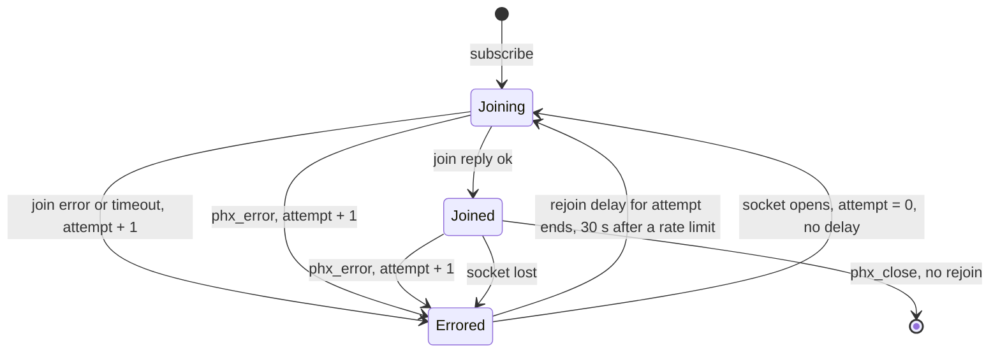

# Subscribe

Register the channel with the server and start receiving events.

## API

Spec: [Realtime Protocol](https://supabase.com/docs/guides/realtime/protocol)

## Behavior

This file covers how a channel gets its subscription back after a join fails,
the server reports a channel error, or the socket reconnects. The caller cannot
configure the rejoin delays.

### Rejoin

The client rejoins a channel when its join fails or times out while the socket
is open. A join times out when it has no reply within the client's request
timeout. The default request timeout is 10 seconds.

Each channel keeps its own rejoin attempt count, starting at 1. The delays are
1, 2, 5, and 10 seconds for attempts 1 to 4, then 10 seconds for every later
attempt. The reconnect delays from [Connect](../client/connect.md) never apply
to a rejoin.

When the server rejects a join with the error code `ChannelRateLimitReached`,
`ConnectionRateLimitReached`, `ClientJoinRateLimitReached`, or
`DatabaseConnectionRateLimitReached`, the next rejoin waits 30 seconds instead.

### Server channel error

The server sends `phx_error` on a channel topic when the channel's server
process fails. The client handles it by these rules, which follow the Phoenix
channel client
([`channel.js`](https://github.com/supabase/phoenix/blob/phoenix-v0.4.5/assets/js/phoenix/channel.js)):

1. A `phx_error` whose `join_ref` differs from the channel's current join ref
   changes nothing, for example one for an abandoned join attempt. The rules
   below apply only to a `phx_error` for the current join.
2. On a joined channel, the client reports the error to the app, marks the
   channel errored, and rejoins with the rejoin delays above while the socket is
   open. A confirmed join resets the attempt count, so the first rejoin waits 1
   second, then 2, 5, and 10 seconds, and 10 seconds for every later attempt. A
   push that waits for a reply from the errored join gets no reply and fails
   when its own timeout ends.
3. On a join in flight, the `phx_error` counts as a failed join attempt. The
   client stops waiting for that join's reply, marks the channel errored, and
   retries with the same rejoin delays. A subscribe call that waits for the join
   keeps waiting for a later join.
4. When a rejoin gets an `ok` join reply, the client reports to the app that the
   channel is subscribed again.
5. When the socket closes during a rejoin delay, the client cancels the delay.
   The channel rejoins when the socket opens again, as
   [After a reconnect](#after-a-reconnect) states.
6. `phx_close` is not an error. The client removes the channel from the socket
   and does not rejoin it.

[Presence State](../presence/presence_state.md) keeps the old presence state
through this rejoin.

### After a reconnect

When a socket opens, the client resets the rejoin attempt count of every channel
to 0, and it rejoins each errored channel at once, without a rejoin delay.

## Related

- [Connect](../client/connect.md): the socket reconnect that triggers an
  immediate rejoin
- [Heartbeat Interval Configuration](../configuration/heartbeat_interval.md): a
  missing heartbeat reply marks every joined channel as errored
