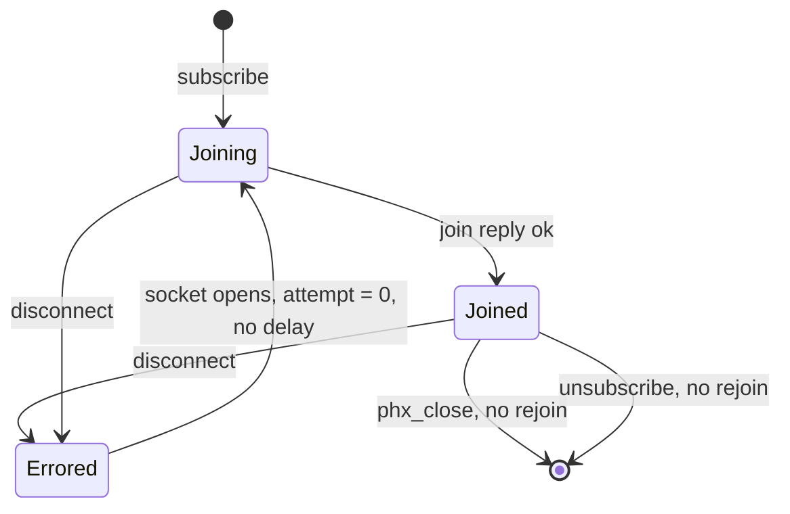

# Disconnect

Close the WebSocket connection to the Realtime server.

## API

Spec: [Realtime Protocol](https://supabase.com/docs/guides/realtime/protocol)

## Behavior

This file covers what a disconnect does to the socket and to the channels the
client holds. The close is the app's choice, so the client does not try to get
the connection back.

### The socket

Disconnect closes the socket. It never schedules a reconnect, and it cancels a
reconnect that is waiting. [Connect](connect.md#when-the-client-reconnects)
states this rule. This file does not change it.

### Channels

Channels stay registered with the client after a disconnect. The app does not
create them again.

When the socket closes on a disconnect, each channel that is not errored,
leaving, or closed becomes errored, and the client reports the error to the app.
The client sends nothing to the server for this. It handles the channel as if
the server had reported a channel error (see
[Server channel error](../channel/subscribe.md#server-channel-error)), except
that no rejoin starts while the socket is closed. A channel that is errored,
leaving, or closed stays as it is.

Errored channels do not rejoin on their own while the socket is closed. They
rejoin only when a socket opens again. A socket opens again when the app calls
`realtime.client.connect`, or when a channel subscribe starts a connect. At that
moment the client rejoins each errored channel at once, without a rejoin delay,
as [Channels after a reconnect](connect.md#channels-after-a-reconnect) and
[After a reconnect](../channel/subscribe.md#after-a-reconnect) state.

The client does not rejoin two kinds of channel:

- A channel the app unsubscribed. It is leaving or closed, so the close leaves
  it as it is.
- A channel the server closed with `phx_close` before the disconnect. The client
  removed it from the socket at that time, so it is not registered any more.

### Pushes in flight

A push that waits for a reply when the disconnect happens gets no reply. It
fails, and the app is told it did not complete. The client never resends it, not
after the channel rejoins and not after the socket opens again. The app sends it
again if it still needs it.

## Related

- [Connect](connect.md): the reconnect rules, and the rejoin of errored channels
  when a socket opens
- [Subscribe](../channel/subscribe.md): how a channel rejoins after an error or
  a reconnect
- Unsubscribe (`realtime.channel.unsubscribe`): a channel the app left is not
  rejoined
