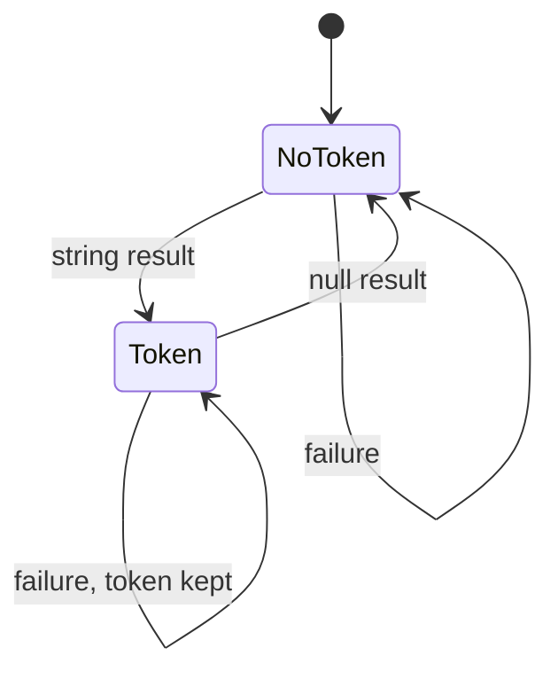

# Dynamic Access Token Callback

## API

Spec: [Realtime protocol](https://supabase.com/docs/guides/realtime/protocol)

## Behavior

The app supplies the callback when it constructs the client. The callback is
asynchronous and returns a string or `null`. The SDK calls it on connect and on
each heartbeat, and applies the result by the rules below.

### Result

The result is the app's statement of the current user.

- A string is the user's access token. The SDK stores it, replacing any token it
  stored before, and pushes it to the joined channels as it does for Set Auth
  Token (`realtime.client.set_auth_token`).
- A `null` result means no signed-in user. The SDK clears the token it stored
  and any expiry it planned a token refresh around. It does so even when the
  stored token came from an earlier call of the callback or from an explicit
  set-auth call.
- A callback that throws, or that does not return within the client's request
  timeout, is a failure and not "no user". The SDK keeps the stored token and
  its planned refresh unchanged.

### Join without a token

With no stored token, the SDK sends `phx_join` without an `access_token` field.
The server then authorizes the join with the API key the socket connected with,
as the
[join handler](https://github.com/supabase/realtime/blob/a937f0d2e110442d9192dbfee7ae7c73496fea0e/lib/realtime_web/channels/realtime_channel.ex#L857-L880)
shows.

### Clearing the token

When a `null` result clears a stored token, the SDK sends an `access_token`
message to each joined channel. The message carries the API key as its value.
When the SDK has no API key, it sends nothing. The server ignores an
`access_token` message whose value is `null`, as the
[message handler](https://github.com/supabase/realtime/blob/a937f0d2e110442d9192dbfee7ae7c73496fea0e/lib/realtime_web/channels/realtime_channel.ex#L577)
shows, so the SDK never sends a `null` value.

A `null` result when no token is stored changes nothing and sends nothing.

### Broadcast over HTTP

While the SDK has no token, a REST broadcast carries no `Authorization` header,
only `apikey`, as [Broadcast via HTTP](../channel/broadcast_http.md) states.

### Umbrella clients

An SDK that holds a session supplies its own callback to the Realtime client.
When there is no session, that callback returns the API key and not `null`. The
token the channels hold then matches the API key the SDK pushes at sign-out.

## Notes

The server ignores an `access_token` message whose value starts with `sb_`, as
the
[message handler](https://github.com/supabase/realtime/blob/a937f0d2e110442d9192dbfee7ae7c73496fea0e/lib/realtime_web/channels/realtime_channel.ex#L570)
shows. With a publishable key, a joined channel therefore keeps its earlier
token after the token is cleared. That holds until the channel rejoins or the
token expires.

## Related

- Set Auth Token (`realtime.client.set_auth_token`): the explicit set-auth call
  that a `null` result overrides
- [Broadcast via HTTP](../channel/broadcast_http.md): the `Authorization` rule
  for a REST broadcast
- [Subscribe](../channel/subscribe.md): the join and rejoin that carry the token
