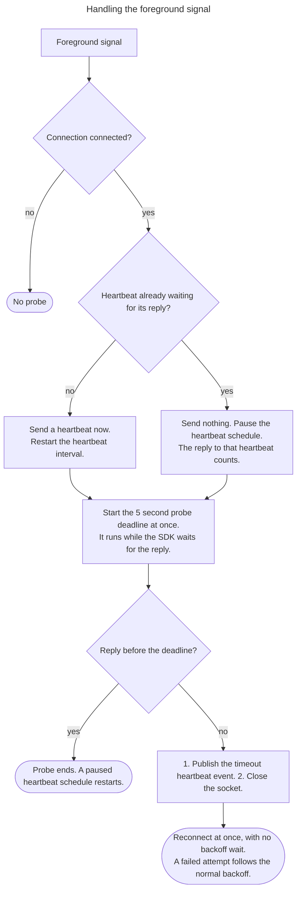
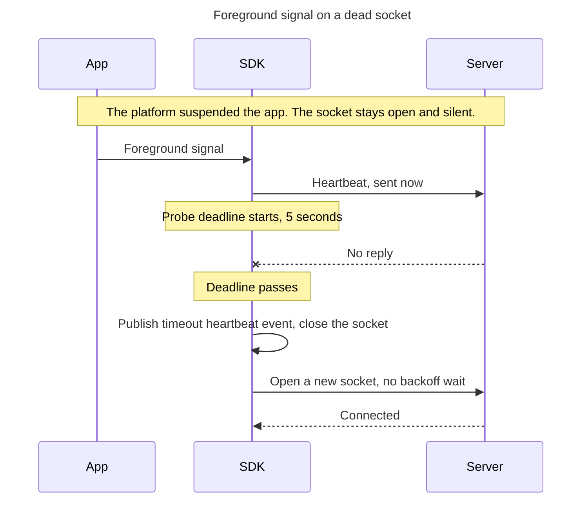

# Foreground Liveness Probe

## Behavior

A platform can suspend an app and leave its socket dead while the SDK still
reports the connection as connected. The next scheduled heartbeat then takes up
to one heartbeat interval to send and one more to time out. The probe finds the
dead socket when the app comes back instead.

The foreground signal is the platform's notification that the app moved from the
background to the foreground. On a desktop platform that keeps the app running
while the machine sleeps, it is the platform's notification that the machine
woke.

On the foreground signal, while the connection is connected, the SDK:

- Sends a heartbeat at once, outside the heartbeat schedule, and restarts the
  heartbeat interval from that moment. When a heartbeat is already waiting for
  its reply, the SDK sends no second one, and the reply to that heartbeat ends
  the probe. The SDK pauses the heartbeat schedule while it waits, because the
  next scheduled heartbeat would fail the socket on the unanswered one, possibly
  before the probe deadline. Platforms that suspend an app make this likely: a
  scheduled tick that was overdue during the suspension runs when the app
  resumes, before the SDK has read the reply.
- Starts a probe deadline of 5 seconds at once, whether or not it sent a
  heartbeat.

A reply to the heartbeat before the deadline ends the probe. When the SDK paused
the heartbeat schedule, the reply restarts the heartbeat interval. Nothing else
changes.

With no reply by the deadline, the SDK handles the probe as a heartbeat timeout:
it publishes the timeout heartbeat event, closes the socket, and starts a
reconnect attempt at once, without the backoff wait. A failure of that attempt
follows the normal reconnect backoff.

The probe runs only while the connection is connected. In every other connection
state the foreground signal does not start a probe.

The SDK does not disconnect on the background signal, and sends no frame of its
own while the app is in the background.

On a dead socket the probe replaces a wait of up to two heartbeat intervals with
one deadline:

## Notes

The probe needs a platform that reports when an app enters the foreground.
Runtimes without that signal have no probe, and `not_applicable` is the right
compliance status for them.

An app that turns off the SDK's handling of app lifecycle turns the probe off
with it.

## Related

- Listen to Heartbeats (`realtime.client.listen_heartbeats`): the probe
  publishes through the same heartbeat events
- Heartbeat Interval Configuration
  (`realtime.configuration.heartbeat_interval`): the interval the probe restarts
- [Network Path Wake](network_path_wake.md): the other signal that cuts a
  reconnect short
