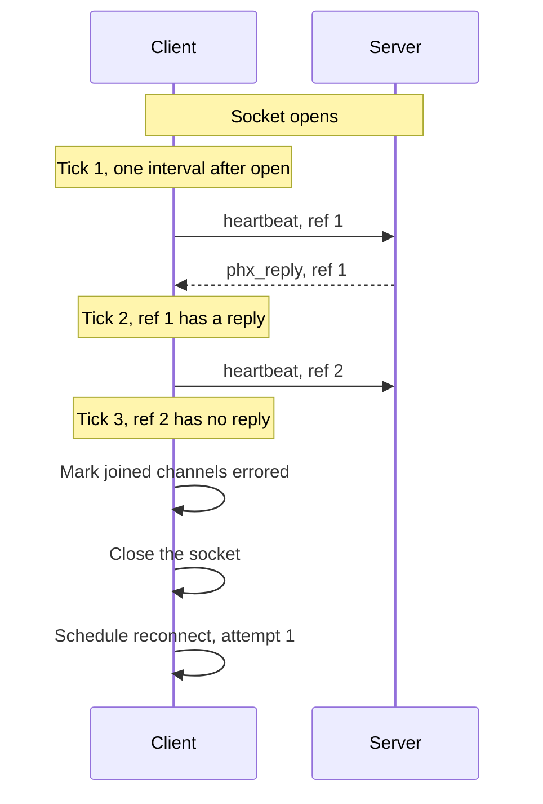

# Heartbeat Interval Configuration

Set how often the Realtime client sends a heartbeat. The same interval bounds how long the client waits for each reply.

## API

Spec: [Realtime Protocol: Heartbeat](https://supabase.com/docs/guides/realtime/protocol#heartbeat)

- `heartbeat` event on the `phoenix` topic, answered by a `phx_reply` with the same `ref`

## Behavior

The client takes the heartbeat interval at construction. The default is 25 seconds. There is no separate setting for the reply wait.

### Sending

The heartbeat cycle starts when a socket opens. The client sends a heartbeat every interval, starting one interval after the open event. When a tick comes and the previous heartbeat has no reply, the client treats the socket as dead instead of sending (see Missing reply). So there is never more than one heartbeat without a reply.

Each heartbeat has a new `ref` that no other message on the socket uses. The cycle stops when the socket closes and starts again when the next socket opens.

The protocol guide asks clients to send a heartbeat at least every 25 seconds. The SDK accepts a longer interval as given and does not raise an error.

### Reply

Only a `phx_reply` whose `ref` matches the heartbeat's `ref` counts as the reply. Other messages on the socket, including channel traffic, do not count.

Any reply proves the socket is alive. A reply with status `ok` and a reply with status `error` have the same effect: the client clears the pending heartbeat, and the next tick sends a new one. A reply does not move the next tick.

### Missing reply

After it sends a heartbeat, the client waits one interval for the reply. When the next tick comes and the heartbeat still has no reply, the client treats the socket as dead. It then does these steps in order:

1. It marks every joined channel as errored, so that each one rejoins when a socket opens again (see [Subscribe](../channel/subscribe.md)).
2. It closes the socket from its side. It does not wait for more messages.
3. It schedules a reconnect (see [Connect](../client/connect.md)). This is attempt 1, because the attempt count reset when the socket opened.

So the client finds a dead socket at most two intervals after the last reply, or after the open event when no reply has come yet. A reply that arrives after the client treated the socket as dead has no effect.

## Related

- [Connect](../client/connect.md): when and how the client reopens a socket that missed a heartbeat reply
- Listen to Heartbeats (`realtime.client.listen_heartbeats`): reports each send, reply, and missing reply to the app
- Dynamic Access Token Callback (`realtime.configuration.access_token_callback`): refreshes the token on each heartbeat
