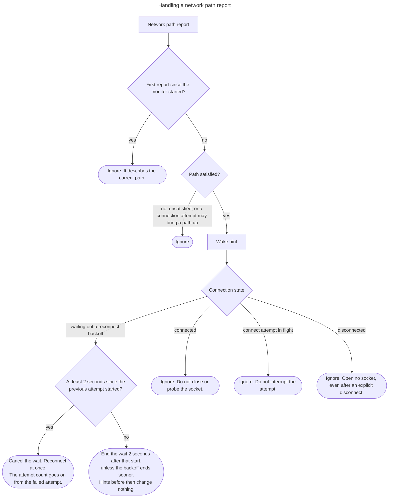

# Network Path Wake

## Behavior

While the connection waits out a reconnect backoff, a report that the network is back lets the SDK retry without sleeping the rest of the wait, which can last up to the longest backoff delay.

The SDK watches the platform's network-path monitor when a boolean option, off or on, enables it. The option defaults to on where the monitor reports a usable path for ordinary apps, and to off elsewhere. When the option is on, the SDK registers the monitor when it creates the client and keeps it until the client is released.

A report that a network path is satisfied, meaning the platform says the device can reach the network, is a wake hint, except for the first report the monitor makes when it starts: that report describes the current path, not a change, and is ignored. A report that the path is unsatisfied is ignored, and so is one that says a connection attempt may bring a path up.

When a wake hint arrives while the connection waits out a reconnect backoff, the SDK cancels the wait and starts a reconnect attempt. The attempt count goes on from the failed attempt, so a failure of that attempt computes its backoff from the next attempt number.

An attempt that a wake hint causes starts no sooner than 2 seconds after the previous attempt started. A path that flaps in bad reception reports "satisfied" again and again, and without this limit each report would start an attempt, which fails fast and wastes battery and server capacity. The limit works like this:

- A hint that arrives at least 2 seconds after the previous attempt started starts the attempt at once.
- A hint that arrives sooner moves the end of the wait to 2 seconds after that start. Further hints before then change nothing.
- The limit never lengthens a wait. When the backoff would end before that time, the backoff schedule applies.

The limit applies to wake hints only. The Foreground Liveness Probe reconnects at once and does not wait for it.

In every other state the SDK ignores a wake hint. It does not open a socket while disconnected, including after an explicit disconnect. It does not close or probe a connected socket. It does not interrupt a connect attempt in flight.

The hint is never a gate. The SDK starts reconnect attempts on the backoff schedule when the monitor reports no usable path, and a connect call neither waits for the monitor nor fails because of it.

## Notes

Some platforms keep reporting an unsatisfied path to ordinary apps, so the hint cannot decide whether to connect. It can only make a wait shorter.

A runtime without a network-path monitor has no wake, and `not_applicable` is the right compliance status for it.

## Related

- [Foreground Liveness Probe](foreground_liveness_probe.md): the other signal that cuts a reconnect short
- Configurable Reconnect Backoff (`realtime.configuration.reconnect_backoff`): the wait the hint cuts short
