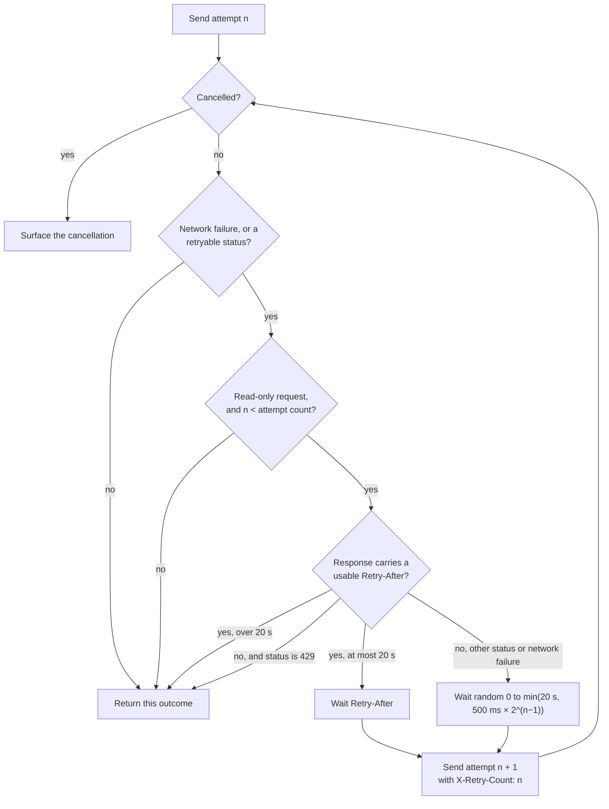

# Automatic Retry

## API

Spec: [https://supabase.github.io/storage/](https://supabase.github.io/storage/)

This feature has no endpoint of its own. The SDK sends the same Storage request
again.

## Behavior

The caller sets the attempt count per client and can do nothing else: the
methods, the statuses, and the delays below are not configurable. Which requests
are safe to send twice is the SDK's decision, not the caller's.

### Which requests retry

A request is retried only when both of these hold:

- It only reads. That is every `GET` and `HEAD` request, plus the two listing
  requests that use `POST` but change nothing: `POST /object/list/{bucketName}`
  and `POST /object/list-v2/{bucketName}`. No other request is sent twice:
  uploads, moves, copies, removals, signed URL creation, and bucket changes can
  take effect twice, and the Storage API takes no idempotency key.
- The attempt failed transiently. Either the HTTP client reported a network
  failure before a response arrived (no connection, a dropped connection, or the
  timeout of a single attempt), or the response status is one of `408`, `429`,
  `500`, `502`, `503`, `504`, `520`, `521`, `522`, `523`, `524`, or `530`. A
  `429` retries only when it carries a usable `Retry-After`: without one there
  is no safe time to come back, and a rate limiter that counts every attempt
  would only charge the caller more.

### Attempts

The caller sets the attempt count per client. The count includes the first
attempt. The default is 3. A count of 1 turns retries off. When the last allowed
attempt fails, its response or its network error is the request's outcome.
Retrying adds no error of its own.

The n-th retry carries the header `X-Retry-Count: n`, so the first retry sends
`X-Retry-Count: 1`. The first attempt carries no such header.

The SDK discards the body of a response it retries. The caller never sees a
response that a later attempt replaced.

### Delay

Before the n-th retry the SDK waits a uniformly random duration in the closed
range from 0 to `min(20 s, 500 ms × 2^(n−1))`. Each wait draws a new random
value. The jitter is required: without it, every client that lost the same
connection retries at the same instant.

When a retryable response carries a `Retry-After` header
([RFC 9110, section 10.2.3](https://www.rfc-editor.org/rfc/rfc9110.html#section-10.2.3)),
the SDK reads it as delta-seconds (a non-negative integer) or as an HTTP-date,
and then:

- A value from 1 s to 20 s: the SDK waits exactly that long, with no jitter.
- A value over 20 s: the SDK does not retry, and this response is the request's
  outcome.
- A value of 0, a date that has passed, or a value the SDK cannot parse: the
  value is not usable. The jittered delay above applies, except to a `429`,
  which is not retried.

### What is never retried

- Cancellation. When the caller cancels the request during an attempt or during
  a wait, the SDK stops at once and surfaces the cancellation. It sends no
  further attempt.
- Errors from caller-supplied code. An error thrown by an access-token callback,
  a request or response interceptor, a progress callback, or any other hook the
  caller supplies is not a network failure. It propagates unchanged and is not
  retried.
- A body the caller is reading. Retries end when the call returns. A download
  that returns a stream does not retry a failure while the caller reads the
  body, because the caller may already have read part of it.

## Related

- [Automatic Retry with Backoff](../../database/configuration/auto_retry.md):
  the database counterpart, with a fixed rule
- [Resumable Upload](../file_buckets/resumable_upload.md): uploads resume by
  their own rules, not by this retry
- [Download as Stream](../file_buckets/download_as_stream.md): where retries
  stop for a streamed download
